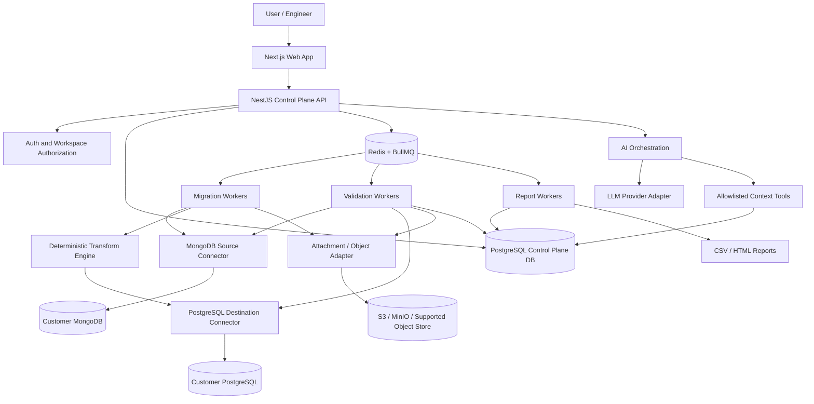
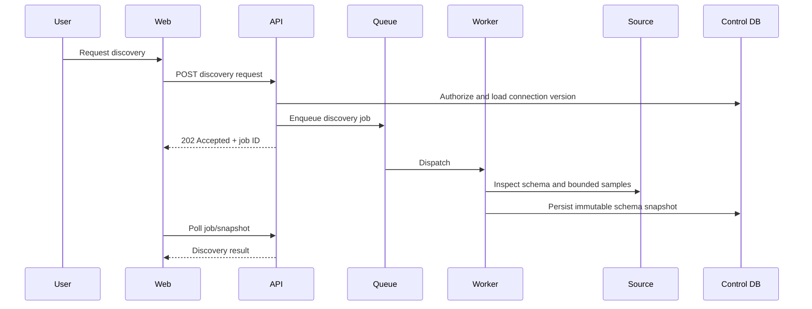
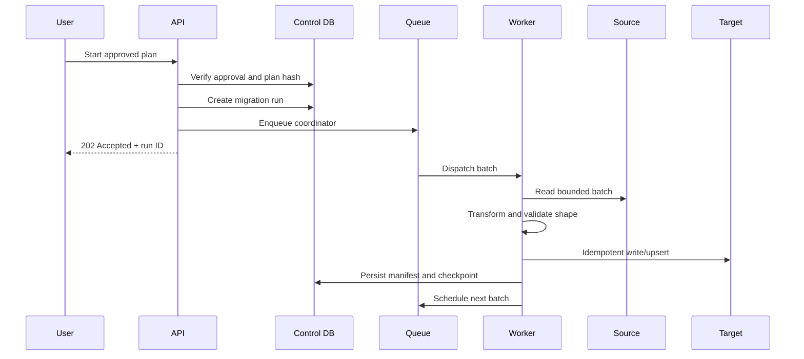
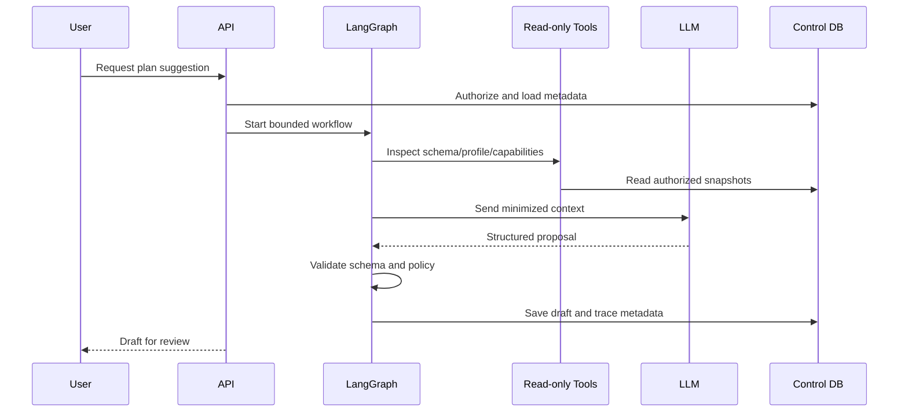

# System Architecture

**Product:** MigrationGuard · **Version:** 0.1 · **Status:** Proposed baseline

## 1. Architecture goals

- Separate control-plane orchestration from data-plane execution.
- Keep source/destination-specific behavior inside connector adapters.
- Keep migration and validation deterministic and testable.
- Use AI for planning and investigation without unrestricted execution rights.
- Support bounded streaming and process-restart recovery.
- Keep AI provider and connector implementations replaceable.

## 2. High-level architecture



## 3. Control plane and data plane

### Control plane

Responsibilities: authentication, workspace authorization, connection metadata/secret references, schema snapshots, profiling jobs, mapping versions, plans, approvals, scheduling, run state, AI tool authorization, audit events and report metadata.

Primary components: Next.js, NestJS, PostgreSQL, Redis/BullMQ and AI orchestration service.

### Data plane

Responsibilities: source reads, deterministic transformations, destination writes, identity mappings, batch manifests, checkpointing, attachment transfer and validation.

Primary components: migration workers, validation workers, connector adapters and object-store adapter.

## 4. Technology baseline

| Layer | Technology | Responsibility |
|---|---|---|
| Web | Next.js + TypeScript | Dashboard, schema explorer, mapping studio, copilot |
| API | NestJS + TypeScript | REST, authorization, plans, workflow orchestration |
| Control DB | PostgreSQL | Plans, mappings, runs, batches, discrepancies, audit |
| Queue | Redis + BullMQ | Background dispatch/retry, not record transport |
| Workers | Node.js/TypeScript initially | Migration, validation, reporting |
| AI workflows | LangGraph behind application boundary | State graphs, bounded tool calls |
| LLM providers | Gemini/OpenAI/Anthropic adapter | Model portability |
| Object storage | MinIO local; S3-compatible deployment | Attachments, temporary artifacts, reports |
| Validation | Custom deterministic engine | Reconciliation, hashes and relationship checks |
| Observability | OpenTelemetry + log/metric backend | Traces, logs and metrics |
| Vector retrieval | pgvector or Qdrant later | Documentation/runbook retrieval, not raw record transport |

Start with a single deployable NestJS API and separate worker process. Split AI into another service only when scaling, language or security boundaries justify it.

## 5. Component responsibilities

### Web application

- Project and connection management.
- Schema explorer and profile views.
- Visual mapping editor and sample preview.
- Plan review and approval.
- Migration monitor and batch inspector.
- Validation discrepancy explorer.
- AI copilot with evidence links.
- Report download and audit timeline.

### Suggested NestJS modules

`AuthModule`, `WorkspaceModule`, `ConnectionModule`, `SchemaModule`, `ProfilingModule`, `MappingModule`, `PlanningModule`, `ApprovalModule`, `MigrationModule`, `ValidationModule`, `ReportModule`, `AuditModule`, `AiModule`, `HealthModule`.

### Worker pools

Separate queues/pools for:

- `schema-discovery`
- `data-profiling`
- `migration-execution`
- `migration-validation`
- `ai-analysis`
- `report-generation`

Separate pools keep slow model calls and report rendering from consuming migration worker capacity.

## 6. Connector contracts

Illustrative TypeScript interfaces:

```ts
export interface SourceConnector {
  testConnection(): Promise<ConnectionTestResult>;
  discoverSchema(options: DiscoveryOptions): Promise<SchemaSnapshot>;
  profile(options: ProfileOptions): Promise<ProfileResult>;
  readBatch(cursor: SourceCursor, options: ReadBatchOptions): Promise<SourceBatch>;
  close(): Promise<void>;
}

export interface DestinationConnector {
  testConnection(): Promise<ConnectionTestResult>;
  inspectSchema(options: DiscoveryOptions): Promise<SchemaSnapshot>;
  writeBatch(batch: TransformedBatch, options: WriteOptions): Promise<WriteResult>;
  readByKeys(keys: StableKey[]): Promise<DestinationRecord[]>;
  close(): Promise<void>;
}
```

Production interfaces also need cancellation, timeouts, cursor semantics, capability discovery, structured error classification, resource cleanup and health checks.

## 7. Runtime flows

### 7.1 Schema discovery



### 7.2 Migration execution



### 7.3 AI plan generation



## 8. Migration plan execution boundary

A plan is a versioned data object, never free-form AI text. It includes source/destination connection IDs and versions, schema snapshot IDs, mapping version, source/target object scope, identity strategy, transformation operations, batch/concurrency settings, write mode, retry policy and validation profile. Only an approved, schema-valid plan hash can execute.

## 9. Source consistency

Record the read-consistency mode, source boundary/cursor and topology metadata used for each run. If a true consistent snapshot cannot be guaranteed for a supported topology, disclose the limitation and require a coordinated write freeze or an explicit best-effort acknowledgement. CDC/cutover are later capabilities.

## 10. Checkpoint and idempotency

- A checkpoint represents the highest source cursor/range whose destination effects and manifest are durable.
- Batch identity is stable for a run and source range/partition.
- Writes use configured stable keys and explicit insert/upsert semantics.
- If a worker crashes after destination commit but before checkpoint commit, replay only when the write is idempotent or reconcile first.
- If an operation cannot be made idempotent and its outcome is unknown, stop for operator reconciliation.

## 11. Validation architecture

Validation uses the exact plan/mapping/canonicalization versions and persisted manifests. It runs count reconciliation, key-set reconciliation, duplicate detection, canonicalized content comparison, relationship checks, attachment presence/size/hash checks and configured metadata/audit checks.

Check states: `PASS`, `FAIL`, `SKIPPED`, `NOT_APPLICABLE`, `ERROR`. A skipped check is never a pass.

## 12. AI boundary

AI may read authorized schema snapshots, aggregate profiles and sanitized logs; propose mappings/plans; explain failure patterns; group discrepancies; and narrate reports.

AI may not receive credentials, open unrestricted DB connections, execute arbitrary SQL/shell/scripts, mutate an approved plan silently, mark validation passed or directly write destination data.

See `07_AI_AGENT_DESIGN.md`.

## 13. Deployment topology

### Local development

Web, API, migration/validation workers, PostgreSQL control DB, Redis, MongoDB source fixture, PostgreSQL target fixture and MinIO for attachment tests. Run via Compose or equivalent.

### Pilot deployment

Deploy web frontend, API and separate worker services; use managed PostgreSQL/Redis, secret manager/KMS and encrypted object storage. Prefer private networking to customer databases. Do not require public database exposure; a customer-side agent/private connector may be a later option.

## 14. Scaling and architecture checks

- Scale worker pools independently and cap per-run/per-connection concurrency.
- Use database constraints for correctness where possible; use locks only for true exclusivity.
- Partition validation by stable key ranges.
- Move high-volume logs/artifacts out of hot transactional tables when measured need arises.
- Add queue fairness and tenant quotas before multi-tenant production scale.
- Verify API responsiveness during migration, worker restart recovery, queue payload minimization, AI-offline operation, workspace isolation and reproducibility of validation evidence.
