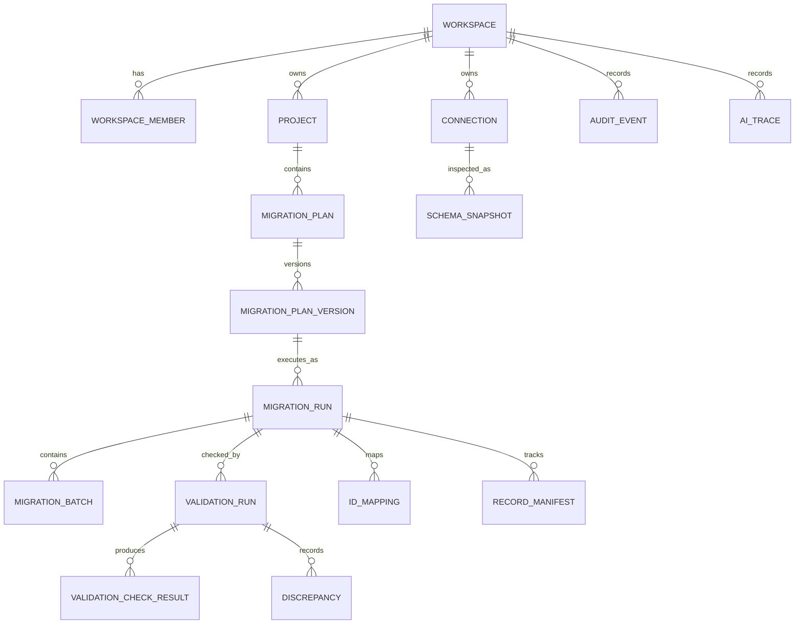

# Data Model and Persistence Design

**Product:** MigrationGuard · **Version:** 0.1 · **Status:** Proposed logical model

## 1. Design principles

- PostgreSQL stores MigrationGuard control-plane metadata.
- Customer records remain in source/destination systems or configured object storage.
- Credentials are encrypted or held in a secret manager; application tables store references only.
- Plans, schema snapshots, mappings and validation rules are versioned/immutable once referenced by a run.
- Large row payloads are not stored in the control database by default.
- Tenant-owned records carry `workspace_id` directly or through a parent with enforced authorization.
- Important state changes create audit events.

## 2. Entity relationship diagram



## 3. Core entities

### `workspaces`

`id UUID PK`, `name TEXT`, `slug TEXT UNIQUE`, `status TEXT`, `created_at TIMESTAMPTZ`, `updated_at TIMESTAMPTZ`.

### `workspace_members`

`id UUID PK`, `workspace_id UUID FK`, `user_id UUID`, `role TEXT`, `created_at TIMESTAMPTZ`. Unique `(workspace_id, user_id)`.

### `projects`

`id UUID PK`, `workspace_id UUID FK`, `name TEXT`, `description TEXT`, `status TEXT`, `created_by UUID`, `created_at`, `updated_at`.

### `connections`

`id UUID PK`, `workspace_id UUID FK`, `name TEXT`, `engine TEXT`, `connection_role TEXT`, `config_json JSONB`, `secret_ref TEXT`, `credential_version INTEGER`, `status TEXT`, `created_by UUID`, `created_at`, `updated_at`.

`config_json` contains non-secret connection metadata only. Do not store password, private key or raw connection string there.

### `schema_snapshots`

`id UUID PK`, `workspace_id UUID`, `connection_id UUID`, `connection_version INTEGER`, `schema_version INTEGER`, `snapshot_json JSONB`, `discovery_metadata JSONB`, `created_at TIMESTAMPTZ`.

Snapshots are immutable; each discovery creates a new row.

### `profile_runs` / `profile_results`

Track profile scope, method, sample size, status and aggregates. Prefer null percentages, type distributions, cardinality estimates and patterns over raw values.

### `migration_plans`

`id UUID PK`, `workspace_id UUID`, `project_id UUID`, `name TEXT`, `status TEXT`, `current_version INTEGER`, `created_by UUID`, `created_at`, `updated_at`.

### `migration_plan_versions`

`id UUID PK`, `plan_id UUID`, `version INTEGER`, `source_connection_id UUID`, `source_schema_snapshot_id UUID`, `destination_connection_id UUID`, `destination_schema_snapshot_id UUID`, `mapping_version_id UUID`, `scope_json JSONB`, `execution_config_json JSONB`, `validation_profile_json JSONB`, `plan_hash TEXT`, `created_by UUID`, `created_at TIMESTAMPTZ`.

A run references an exact plan version, never a mutable plan draft.

### `mapping_versions`

`id UUID PK`, `workspace_id UUID`, `plan_id UUID`, `version INTEGER`, `mapping_json JSONB`, `mapping_hash TEXT`, `created_by UUID`, `created_at TIMESTAMPTZ`.

Transformation operations must use an allowlisted vocabulary.

### `approvals`

`id UUID PK`, `workspace_id UUID`, `resource_type TEXT`, `resource_id UUID`, `resource_hash TEXT`, `approval_status TEXT`, `approver_user_id UUID`, `comment TEXT`, `approved_at TIMESTAMPTZ`.

Approval is valid only for the exact resource hash.

### `migration_runs`

`id UUID PK`, `workspace_id UUID`, `project_id UUID`, `plan_version_id UUID`, `status TEXT`, `source_boundary_json JSONB`, `started_at TIMESTAMPTZ`, `completed_at TIMESTAMPTZ`, `progress_json JSONB`, `last_error_code TEXT`, `created_by UUID`, `created_at`, `updated_at`.

### `migration_batches`

`id UUID PK`, `migration_run_id UUID`, `batch_key TEXT`, `sequence_no BIGINT`, `status TEXT`, `source_cursor_start JSONB`, `source_cursor_end JSONB`, `records_read BIGINT`, `records_written BIGINT`, `records_skipped BIGINT`, `records_failed BIGINT`, `attempt_count INTEGER`, `started_at`, `completed_at`, `error_summary JSONB`.

Unique `(migration_run_id, batch_key)`.

### `record_manifests`

Tracks records or source-key ranges processed by a run. At scale, prefer compact range manifests or partitioned storage over one hot-table row per record. Fields can include run/batch IDs, source-key hash, destination key, content hash, outcome and manifest version.

### `id_mappings`

`id UUID PK`, `migration_run_id UUID`, `source_object TEXT`, `source_key TEXT`, `destination_object TEXT`, `destination_key TEXT`, `created_at TIMESTAMPTZ`.

Unique `(migration_run_id, source_object, source_key)`. Protect or hash sensitive identifiers when appropriate.

### `validation_runs`

`id UUID PK`, `workspace_id UUID`, `migration_run_id UUID`, `status TEXT`, `validation_profile_version TEXT`, `canonicalization_version TEXT`, `started_at`, `completed_at`, `summary_json JSONB`.

### `validation_check_results`

One row per check/partition. Store check ID/version, status, evaluated/pass/fail/skipped counts, duration and evidence reference.

### `discrepancies`

`id UUID PK`, `validation_run_id UUID`, `migration_batch_id UUID NULL`, `category TEXT`, `severity TEXT`, `source_object TEXT`, `source_key_ref TEXT`, `destination_object TEXT`, `destination_key_ref TEXT`, `field_path TEXT`, `evidence_ref TEXT`, `summary TEXT`, `status TEXT`, `created_at`, `updated_at`.

Store sensitive before/after values in restricted evidence storage, not indiscriminately in list rows.

### `ai_traces`

Record workflow ID, workspace/project/run references, provider, model, prompt-template version, tool names, output schema version, status, latency and usage/cost metadata where available. Do not retain raw prompt context containing customer data unless explicitly permitted.

### `audit_events`

Append-only event with actor type/ID, workspace, action, resource type/ID, timestamp, correlation ID and sanitized details JSON. Restrict update/delete privileges.

### `report_artifacts`

Store report type, validation/run ID, object-storage reference, checksum, size, generation status, retention expiry and created-by details.

## 4. Indexing guidance

- Workspace list queries: `(workspace_id, created_at DESC)`.
- Active runs: `(workspace_id, status, updated_at DESC)`.
- Batches: unique `(migration_run_id, batch_key)` and `(migration_run_id, sequence_no)`.
- Discrepancies: `(validation_run_id, severity, category)` and status filters.
- Partition large audit/manifests only after volume measurements.
- Promote frequently filtered JSONB attributes to typed columns; avoid speculative indexes.

## 5. Transaction boundaries

- Plan version and approval creation should be transactional.
- Batch manifest/checkpoint persistence needs an explicit recovery protocol relative to destination writes.
- Do not assume a distributed transaction across control DB, destination DB and object storage.
- Attachment manifests use states such as `PENDING`, `UPLOADED`, `VERIFIED`, `FAILED`; uploads should be idempotent by deterministic object key/content hash where appropriate.

## 6. Retention and deletion

Define retention for connection metadata, schema snapshots, profiles, logs, manifests, discrepancy evidence, reports, AI traces and audit events. Workspace deletion must not silently remove evidence subject to contractual or legal retention. Define an explicit deletion/export/retention-exception workflow before production launch.

## 7. Illustrative SQL constraints

```sql
CREATE UNIQUE INDEX uq_batch_run_key
  ON migration_batches (migration_run_id, batch_key);

CREATE UNIQUE INDEX uq_id_mapping_source
  ON id_mappings (migration_run_id, source_object, source_key);

CREATE INDEX ix_runs_workspace_status
  ON migration_runs (workspace_id, status, updated_at DESC);

CREATE INDEX ix_discrepancies_validation_status
  ON discrepancies (validation_run_id, status, severity, category);
```

Final DDL must include foreign keys, check constraints, tenant isolation strategy and indexes validated against query plans.
