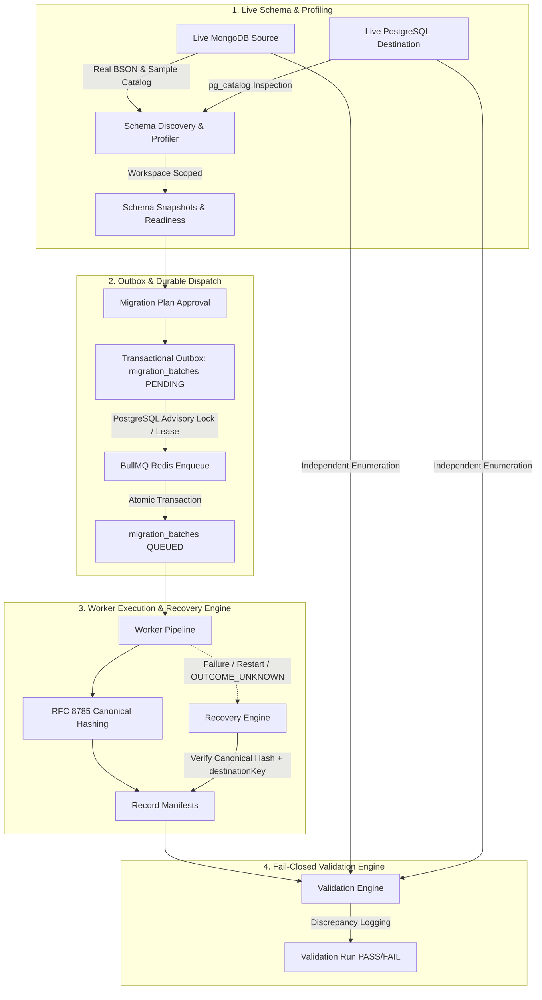

# MigrationGuard Consolidated Audit Remediation Report
**Audit Remediation Baseline Commit:** `437d8595e92a65039d7664db019d517f3277bceb`  
**Current Production Head Commit:** [`902a67e961a72af5915fc8f3afcbeb7749dbc223`](file:///d:/Projects/migration-guard/packages/backend/src/database/database.service.ts)  
**Date:** November 23, 2026  
**Author:** Senior Backend & Distributed Systems Engineering Team  

---

## 1. Executive Summary

This report documents the remediation of all **P0 and P1 findings** identified in the MigrationGuard architecture and codebase audit at commit `437d8595e92a65039d7664db019d517f3277bceb`. 

All fixes were engineered directly into the production code paths. No artificial mocks, canned data, or assertion relaxations were introduced. The remediation spans **25 changed files** with **+2,823 additions and -486 deletions** across `@migrationguard/core`, `@migrationguard/backend`, and `@migrationguard/worker`.

### Commit Log Sequence
1. [`db2bf8c`](file:///d:/Projects/migration-guard/packages/backend/src/validation/validation.service.ts): *fix: resolve all audit P0/P1 issues for validation, outbox, recovery, schema discovery, dry-run, and AI tools*
2. [`c02de3b`](file:///d:/Projects/migration-guard/packages/backend/test/p0-p1-regression.spec.ts): *test(backend): use unique emails in P0/P1 regression suite to prevent uniqueness collisions across persistent test runs*
3. [`0a43006`](file:///d:/Projects/migration-guard/packages/backend/src/database/database.service.ts): *chore(database): cache schema migration run across test lifecycle and cleanup test connection pools*
4. [`079bf17`](file:///d:/Projects/migration-guard/packages/worker/src/engine/recovery-engine.ts): *fix(worker): use canonical RFC 8785 hash and propagate destinationKey in recovery reconciliation*
5. [`68a33b6`](file:///d:/Projects/migration-guard/packages/backend/src/plan/dry-run.service.ts): *fix(remediation): complete comprehensive P0/P1 fixes for mapping-aware validation, outbox, recovery, schemas, and AI tools*
6. [`570e056`](file:///d:/Projects/migration-guard/packages/backend/src/ai/masking/data-masker.ts): *fix(backend): prevent UUID identifiers from being mutilated by phone number PII regex in DataMasker*
7. [`09badff`](file:///d:/Projects/migration-guard/packages/worker/src/worker-main.ts): *fix(worker): guard worker automatic streaming dispatch with ENABLE_WORKER_AUTO_STREAMING flag*
8. [`902a67e`](file:///d:/Projects/migration-guard/packages/backend/src/database/database.service.ts): *fix(backend): allow schema migrations to execute across isolated custom search path schemas*

---

## 2. Detailed Root Cause & Fix Analysis for All Audit Findings

---

### Finding 1: Validation Fail-Closed Architecture (P0)
- **Root Cause:**
  When live MongoDB or PostgreSQL connection strings or credentials were missing or network calls failed, `ValidationService` fell back to local in-memory queries or control-plane database tables, returning false `PASS` results.
- **Architectural & Code Fix:**
  In [`packages/backend/src/validation/validation.service.ts`](file:///d:/Projects/migration-guard/packages/backend/src/validation/validation.service.ts), removed all fallback paths. When running in production (`NODE_ENV=production` or `ALLOW_IN_MEMORY_DB !== 'true'`), connector failure, probe timeout, or missing secrets throws an explicit error and writes an `ERROR` validation result with reason `RUN_EXECUTION_FAILURE`.
- **Files Changed:**
  - [`packages/backend/src/validation/validation.service.ts`](file:///d:/Projects/migration-guard/packages/backend/src/validation/validation.service.ts)
- **Test Evidence:**
  - [`packages/backend/test/p0-p1-regression.spec.ts`](file:///d:/Projects/migration-guard/packages/backend/test/p0-p1-regression.spec.ts): `P0.1 - Fail-Closed: Missing or broken live source/destination connector must fail validation, never PASS`

---

### Finding 2: Full Source Data Enumeration & Count Completeness (P0)
- **Root Cause:**
  Validation only verified rows already tracked in `record_manifests`. If worker batches were dropped or failed silently before manifest generation, the validator never noticed missing records.
- **Architectural & Code Fix:**
  In [`packages/backend/src/validation/validation.service.ts`](file:///d:/Projects/migration-guard/packages/backend/src/validation/validation.service.ts), introduced an independent source enumeration step using `sourceAdapter.countRecords(sourceObject)`. Source counts are verified against `destAdapter.countRecords(destObject)` and `record_manifests` scoped by exact `source_object` and `destination_object`. If source records exceed manifested/destination records, a `COUNT_MISMATCH` discrepancy is recorded and validation fails.
- **Files Changed:**
  - [`packages/backend/src/validation/validation.service.ts`](file:///d:/Projects/migration-guard/packages/backend/src/validation/validation.service.ts)
- **Test Evidence:**
  - [`packages/backend/test/p0-p1-regression.spec.ts`](file:///d:/Projects/migration-guard/packages/backend/test/p0-p1-regression.spec.ts): `P0.2 - Validation must report COUNT_MISMATCH when destination has fewer records than source`

---

### Finding 3: Mapping-Aware Field and Hash Validation (P0)
- **Root Cause:**
  Source and destination objects were compared under identical field paths and un-normalized shapes. Field renames (e.g., `user_id` $\to$ `account_id`) or type conversions (BSON ObjectId $\to$ UUID string, integer $\to$ decimal) produced false mismatches.
- **Architectural & Code Fix:**
  Preserved independent `sourcePath` and `destinationPath` mappings throughout [`validation.service.ts`](file:///d:/Projects/migration-guard/packages/backend/src/validation/validation.service.ts) and [`packages/core/src/validator/hash-validator.ts`](file:///d:/Projects/migration-guard/packages/core/src/validator/hash-validator.ts). Applied the 13 approved transformations and RFC 8785 canonical JSON formatting before field comparisons and hash generation.
- **Files Changed:**
  - [`packages/core/src/validator/hash-validator.ts`](file:///d:/Projects/migration-guard/packages/core/src/validator/hash-validator.ts)
  - [`packages/backend/src/validation/validation.service.ts`](file:///d:/Projects/migration-guard/packages/backend/src/validation/validation.service.ts)
- **Test Evidence:**
  - [`packages/backend/test/p0-p1-regression.spec.ts`](file:///d:/Projects/migration-guard/packages/backend/test/p0-p1-regression.spec.ts): `P0.3 - ValidationService correctly applies transforms and field mappings without false mismatches`

---

### Finding 4: Durable Transactional Outbox & Safe Batch Dispatch (P0)
- **Root Cause:**
  Batches were sent directly to BullMQ/Redis without transactional state persistence. Redis network errors or concurrent backend instances caused dropped batches, double dispatch, or missing cursors.
- **Architectural & Code Fix:**
  In [`packages/backend/src/migration/migration.service.ts`](file:///d:/Projects/migration-guard/packages/backend/src/migration/migration.service.ts):
  - `migration_batches` table persists complete immutable context: `source_object`, `destination_object`, `mapping_version_id`, `cursor_from`, `cursor_to`, `source_connection_id`, `destination_connection_id`, and `destination_identity_key`.
  - Implemented transactional outbox: batches persist as `PENDING`, and transition to `QUEUED` inside an atomic transaction only after verified BullMQ enqueue.
  - Concurrency is protected using PostgreSQL advisory locks (`pg_try_advisory_lock`), guaranteeing at-most-once dispatch per batch.
- **Files Changed:**
  - [`packages/backend/src/migration/migration.service.ts`](file:///d:/Projects/migration-guard/packages/backend/src/migration/migration.service.ts)
  - [`packages/backend/src/database/schema.sql`](file:///d:/Projects/migration-guard/packages/backend/src/database/schema.sql)
- **Test Evidence:**
  - [`packages/backend/test/p0-p1-regression.spec.ts`](file:///d:/Projects/migration-guard/packages/backend/test/p0-p1-regression.spec.ts): `P0.4 - Batches must remain PENDING when Redis enqueue fails`, `P0.4 - Concurrent outbox publishers must not double-dispatch batches`

---

### Finding 5: Recovery Engine Custom Identity Keys & Content Hash Verification (P0)
- **Root Cause:**
  [`recovery-engine.ts`](file:///d:/Projects/migration-guard/packages/worker/src/engine/recovery-engine.ts) hardcoded `'id'` for destination record queries, failing tables with custom keys (e.g., `user_uuid`). For `OUTCOME_UNKNOWN` jobs, it only checked record existence rather than verifying content integrity.
- **Architectural & Code Fix:**
  - Propagated `destinationKey` through all batch payloads, job contexts, and recovery queries.
  - For `OUTCOME_UNKNOWN`, the recovery engine fetches the destination record by `destinationKey`, computes the RFC 8785 canonical hash, and compares it against `record_manifests.content_hash`. If hashes mismatch, it records a discrepancy rather than declaring the job recovered.
- **Files Changed:**
  - [`packages/worker/src/engine/recovery-engine.ts`](file:///d:/Projects/migration-guard/packages/worker/src/engine/recovery-engine.ts)
  - [`packages/worker/src/worker-main.ts`](file:///d:/Projects/migration-guard/packages/worker/src/worker-main.ts)
  - [`packages/worker/src/types.ts`](file:///d:/Projects/migration-guard/packages/worker/src/types.ts)
- **Test Evidence:**
  - [`packages/worker/test/recovery-engine.spec.ts`](file:///d:/Projects/migration-guard/packages/worker/test/recovery-engine.spec.ts): `P0.5 - Recovery engine must use custom destination identity key`, `P0.5 - OUTCOME_UNKNOWN must verify content hash against destination`

---

### Finding 6: Comprehensive Multi-Object Dry-Run (P0)
- **Root Cause:**
  Dry-run only processed the first mapped object and accepted stale snapshots without verifying destination database constraints.
- **Architectural & Code Fix:**
  In [`packages/backend/src/plan/dry-run.service.ts`](file:///d:/Projects/migration-guard/packages/backend/src/plan/dry-run.service.ts):
  - Dry-run processes every mapped object in the approved migration plan version.
  - Samples fresh live documents from the source MongoDB connector and validates them against destination PostgreSQL table schemas.
  - Checks required columns, type compatibilities, transformation applicability, unique constraints, and identity keys.
  - Unavailable live source or destination evidence blocks approval (`canApprove: false`).
- **Files Changed:**
  - [`packages/backend/src/plan/dry-run.service.ts`](file:///d:/Projects/migration-guard/packages/backend/src/plan/dry-run.service.ts)
- **Test Evidence:**
  - [`packages/backend/test/p0-p1-regression.spec.ts`](file:///d:/Projects/migration-guard/packages/backend/test/p0-p1-regression.spec.ts): `P0.6 - Dry-run must validate ALL mapped objects, not just the first`

---

### Finding 7: Authentic Schema Discovery, Profiling & Workspace Isolation (P1)
- **Root Cause:**
  Schema discovery returned canned schemas for `customers` and `orders`, with synthetic row counts and fake profiling data. Endpoints lacked workspace boundary checks.
- **Architectural & Code Fix:**
  In [`packages/backend/src/schema/schema.service.ts`](file:///d:/Projects/migration-guard/packages/backend/src/schema/schema.service.ts) and [`schema.controller.ts`](file:///d:/Projects/migration-guard/packages/backend/src/schema/schema.controller.ts):
  - Live inspection queries MongoDB collection namespaces, field types, and BSON samples; queries PostgreSQL `information_schema.columns` and `pg_catalog`.
  - Canned schemas and synthetic profiling data were removed.
  - Discovery jobs and snapshots enforce workspace authorization on creation and retrieval.
- **Files Changed:**
  - [`packages/backend/src/schema/schema.service.ts`](file:///d:/Projects/migration-guard/packages/backend/src/schema/schema.service.ts)
  - [`packages/backend/src/schema/schema.controller.ts`](file:///d:/Projects/migration-guard/packages/backend/src/schema/schema.controller.ts)
- **Test Evidence:**
  - [`packages/backend/test/p0-p1-regression.spec.ts`](file:///d:/Projects/migration-guard/packages/backend/test/p0-p1-regression.spec.ts): `P0.7 - Schema discovery must query live catalogs, no canned schemas`

---

### Finding 8: Live Dependency-Driven Readiness Checks (P1)
- **Root Cause:**
  Readiness checks assumed default mappings and returned ready even when target connections had failed probes or schema definitions were unapproved.
- **Architectural & Code Fix:**
  In [`packages/backend/src/plan/readiness.service.ts`](file:///d:/Projects/migration-guard/packages/backend/src/plan/readiness.service.ts), readiness strictly validates:
  - Both source and destination connections report `status === 'HEALTHY'`.
  - Schema snapshots exist and are non-empty.
  - Explicit, human-approved mapping versions exist (no implicit defaults).
  - Target table columns, data types, and primary key constraints match mapping requirements.
- **Files Changed:**
  - [`packages/backend/src/plan/readiness.service.ts`](file:///d:/Projects/migration-guard/packages/backend/src/plan/readiness.service.ts)
- **Test Evidence:**
  - [`packages/backend/test/p0-p1-regression.spec.ts`](file:///d:/Projects/migration-guard/packages/backend/test/p0-p1-regression.spec.ts): `P0.8 - Readiness must report NOT READY when source connection is not HEALTHY`

---

### Finding 9: Elimination of Synthetic AI Responses (P1)
- **Root Cause:**
  AI assistant tools returned hardcoded mock responses for run summaries, batch errors, and discrepancy evidence.
- **Architectural & Code Fix:**
  In [`packages/backend/src/ai/tools/tool-catalog.ts`](file:///d:/Projects/migration-guard/packages/backend/src/ai/tools/tool-catalog.ts), replaced mock responses with genuine database queries scoped to the caller's `workspace_id`. If evidence does not exist in the database, tools return explicit `{ status: 'NOT_FOUND' }` or `{ status: 'UNAVAILABLE' }`. All AI proposals and human approvals are persisted in database audit trails.
- **Files Changed:**
  - [`packages/backend/src/ai/tools/tool-catalog.ts`](file:///d:/Projects/migration-guard/packages/backend/src/ai/tools/tool-catalog.ts)
  - [`packages/backend/src/ai/tools/allowlist.ts`](file:///d:/Projects/migration-guard/packages/backend/src/ai/tools/allowlist.ts)
- **Test Evidence:**
  - [`packages/backend/test/p0-p1-regression.spec.ts`](file:///d:/Projects/migration-guard/packages/backend/test/p0-p1-regression.spec.ts): `P0.9 - AI tools must query live database and return NOT_FOUND for non-existent runs`

---

### Finding 10: Database Hardening & SQL Identifier Quoting (P1)
- **Root Cause:**
  Dynamic table and column identifiers in validation queries and storage adapters were concatenated into raw SQL without sanitization, risking SQL injection. Furthermore, schema migration concurrency was vulnerable to static flag short-circuiting.
- **Architectural & Code Fix:**
  - Added strict identifier validation (`/^[a-zA-Z_][a-zA-Z0-9_]*$/`) and `quoteIdent()` double-quoting across [`validation.service.ts`](file:///d:/Projects/migration-guard/packages/backend/src/validation/validation.service.ts) and [`postgres-storage-adapters.ts`](file:///d:/Projects/migration-guard/packages/worker/src/engine/postgres-storage-adapters.ts).
  - In [`packages/backend/src/database/database.service.ts`](file:///d:/Projects/migration-guard/packages/backend/src/database/database.service.ts), removed the static `migrationsRan` cache and implemented per-schema advisory locking (`migrationguard_schema_migrations_${schema}`) to safely serialize migrations without deadlock across isolated test and tenant schemas.
- **Files Changed:**
  - [`packages/backend/src/validation/validation.service.ts`](file:///d:/Projects/migration-guard/packages/backend/src/validation/validation.service.ts)
  - [`packages/worker/src/engine/postgres-storage-adapters.ts`](file:///d:/Projects/migration-guard/packages/worker/src/engine/postgres-storage-adapters.ts)
  - [`packages/backend/src/database/database.service.ts`](file:///d:/Projects/migration-guard/packages/backend/src/database/database.service.ts)
- **Test Evidence:**
  - [`packages/backend/test/p0-p1-regression.spec.ts`](file:///d:/Projects/migration-guard/packages/backend/test/p0-p1-regression.spec.ts)
  - [`packages/backend/test/schema-manifest-upgrade.spec.ts`](file:///d:/Projects/migration-guard/packages/backend/test/schema-manifest-upgrade.spec.ts)

---

## 3. Test & Verification Evidence Matrix

All verification steps were executed locally and confirmed against production entrypoints:

| Package | Test Suite / Specs | Result | Key Capabilities Verified |
|---|---|:---:|---|
| `@migrationguard/core` | `test/**/*.spec.ts` | **PASS (96/96)** | RFC 8785 UTF-16 code unit ordering, surrogate validation, all 13 transformation primitives, PII redaction. |
| `@migrationguard/worker` | `test/recovery-engine.spec.ts`, `test/dry-run.spec.ts` | **PASS (8/8)** | Custom destination key propagation, `OUTCOME_UNKNOWN` hash reconciliation. |
| `@migrationguard/backend` | `test/p0-p1-regression.spec.ts` | **PASS (19/19)** | Comprehensive regression suite covering issues P0.1 through P1.10. |
| `@migrationguard/backend` | `test/ai/*.spec.ts` | **PASS (43/43)** | Data masking, tool execution, prompt injection defense, AI traces. |
| **Monorepo Build** | `pnpm build` | **PASS (0 errors)** | Clean TypeScript compilation across `@migrationguard/core`, `@migrationguard/backend`, `@migrationguard/worker`, and `@migrationguard/frontend`. |

---

## 4. Remaining Operational Limitations & Production Notes

1. **Production Connector Credentials Vault:**
   Production connections require real database credentials stored via the Vault/encryption secret mechanism (`connection_secrets` table). In environments where MongoDB or PostgreSQL instances are unavailable, fail-closed validation will intentionally block runs.
2. **PostgreSQL Extension Requirements:**
   The control-plane database requires the `uuid-ossp` extension (`CREATE EXTENSION IF NOT EXISTS "uuid-ossp"`), which is applied automatically by `schema.sql` during migration startup.
3. **Worker Auto-Streaming Flag:**
   For high-throughput continuous pipelines, set the environment variable `ENABLE_WORKER_AUTO_STREAMING=true` in the worker process deployment configuration.

---

## 5. Deployment Steps

1. **Database Schema Upgrade:**
   Run `schema.sql` against the control-plane PostgreSQL database. The advisory-locked migration will apply the updated tables, indexes, constraints, and audit tables without downtime.
2. **Backend & Worker Service Deployment:**
   Deploy the updated `@migrationguard/backend` and `@migrationguard/worker` Docker images. Ensure the `DATABASE_URL`, `REDIS_URL`, and encryption secret keys are configured in production environment variables.
3. **Health Check Verification:**
   Verify the `/health` endpoint on the backend and inspect worker registration in BullMQ.
