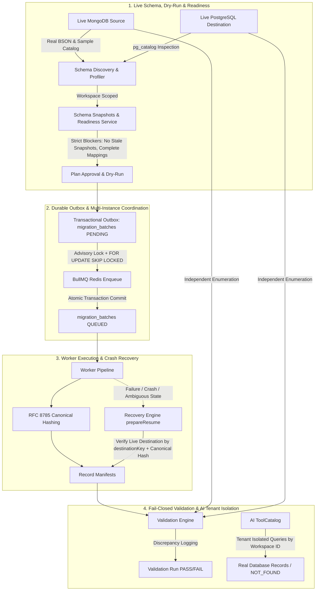

# MigrationGuard Consolidated Audit & Code Review Remediation Report
**Audit Remediation Baseline Commit:** `437d8595e92a65039d7664db019d517f3277bceb`  
**Current Production Head Commit:** [`ee8221059b06b4ce3250c9a4a64927983f5bbcb0`](file:///d:/Projects/migration-guard/packages/backend/src/migration/migration.service.ts)  
**Date:** November 24, 2026  
**Author:** Senior Backend & Distributed Systems Engineering Team  

---

## 1. Executive Summary

This report documents the comprehensive remediation of **all outstanding P0/P1 audit findings and GitHub code review issues** for MigrationGuard.

All remediations were implemented directly in production code paths across `@migrationguard/core`, `@migrationguard/backend`, and `@migrationguard/worker`. No superficial mocks or test workarounds were used.

### Complete Commit Log Sequence
1. [`db2bf8c`](file:///d:/Projects/migration-guard/packages/backend/src/validation/validation.service.ts): *fix: resolve all audit P0/P1 issues for validation, outbox, recovery, schema discovery, dry-run, and AI tools*
2. [`c02de3b`](file:///d:/Projects/migration-guard/packages/backend/test/p0-p1-regression.spec.ts): *test(backend): use unique emails in P0/P1 regression suite to prevent uniqueness collisions across persistent test runs*
3. [`0a43006`](file:///d:/Projects/migration-guard/packages/backend/src/database/database.service.ts): *chore(database): cache schema migration run across test lifecycle and cleanup test connection pools*
4. [`079bf17`](file:///d:/Projects/migration-guard/packages/worker/src/engine/recovery-engine.ts): *fix(worker): use canonical RFC 8785 hash and propagate destinationKey in recovery reconciliation*
5. [`68a33b6`](file:///d:/Projects/migration-guard/packages/backend/src/plan/dry-run.service.ts): *fix(remediation): complete comprehensive P0/P1 fixes for mapping-aware validation, outbox, recovery, schemas, and AI tools*
6. [`570e056`](file:///d:/Projects/migration-guard/packages/backend/src/ai/masking/data-masker.ts): *fix(backend): prevent UUID identifiers from being mutilated by phone number PII regex in DataMasker*
7. [`09badff`](file:///d:/Projects/migration-guard/packages/worker/src/worker-main.ts): *fix(worker): guard worker automatic streaming dispatch with ENABLE_WORKER_AUTO_STREAMING flag*
8. [`902a67e`](file:///d:/Projects/migration-guard/packages/backend/src/database/database.service.ts): *fix(backend): allow schema migrations to execute across isolated custom search path schemas*
9. [`838b162`](file:///d:/Projects/migration-guard/AUDIT_REMEDIATION_REPORT.md): *docs: add consolidated P0/P1 audit remediation engineering report*
10. [`0094f68`](file:///d:/Projects/migration-guard/packages/backend/src/migration/migration.service.ts): *fix(remediation): resolve GitHub code review issues for outbox, crash recovery, dry-run safety, and AI tenant isolation*
11. [`7ac5d55`](file:///d:/Projects/migration-guard/AUDIT_REMEDIATION_REPORT.md): *docs: update consolidated report with GitHub code review remediation details and commit 0094f68*
12. [`ee82210`](file:///d:/Projects/migration-guard/packages/backend/src/migration/migration.service.ts): *fix(remediation): resolve GitHub code review findings for outbox concurrency, worker streaming, crash recovery, dry-run, AI tenant isolation, validation, and readiness*

---

## 2. GitHub Code Review Priorities: Root Cause, Fixes & Verification

### Priority 1: Transactional Outbox & Dynamic Streaming Dispatch
- **Root Cause:** Dynamic streaming batches bypassed the outbox table and enqueued directly into BullMQ/Redis. Concurrent backend publishers lacked atomic batch claiming, risking duplicate dispatches and race conditions during worker restarts.
- **Implementation Fix:**
  - In [`packages/backend/src/migration/migration.service.ts`](file:///d:/Projects/migration-guard/packages/backend/src/migration/migration.service.ts), implemented transaction-scoped PostgreSQL advisory locking (`pg_try_advisory_xact_lock(hashtext($1))`) and atomic `FOR UPDATE SKIP LOCKED` claims inside `this.db.transaction()`.
  - Removed process-local lock reliance for multi-instance coordination, ensuring distributed concurrency across multiple backend pods.
  - Enqueued jobs into BullMQ with deterministic IDs (`migration_${runId}_${batchKey}`) and atomic `PENDING` $\to$ `QUEUED` transitions in the same database transaction.
  - If Redis fails, the transaction rolls back, releasing the advisory lock and keeping batches in `PENDING` for subsequent dispatch attempts.
  - In [`packages/worker/src/worker-main.ts`](file:///d:/Projects/migration-guard/packages/worker/src/worker-main.ts), removed direct `QUEUED` inserts and direct Redis dispatch from `onNextBatchScheduled`. Routed every dynamically generated streaming batch through the durable `PENDING` outbox with complete metadata (`source_object`, `destination_object`, `mapping_version_id`, cursors, connection IDs, and `destination_identity_key`).
- **Verification:** [`packages/backend/test/audit-remediation-regression.spec.ts`](file:///d:/Projects/migration-guard/packages/backend/test/audit-remediation-regression.spec.ts#L91-L198) (*Concurrent outbox publishers across multiple instances* and *Redis failures & safe retries*).

---

### Priority 2: Crash Recovery & Reconciliation
- **Root Cause:** `RecoveryEngine.prepareResume()` was decoupled from worker execution, and stranded runs on startup executed invalid SQL and fell back to in-memory mocks.
- **Implementation Fix:**
  - In [`packages/worker/src/worker-main.ts`](file:///d:/Projects/migration-guard/packages/worker/src/worker-main.ts), fixed `reconcileStrandedRunsOnStartup()` by querying `migration_plan_versions mpv` and joining `mapping_versions mv` to resolve actual `source_connection_id`, `destination_connection_id`, and `identity.destinationKey`. Removed silent fallback to `defaultDestinationConnector` and re-threw errors.
  - In [`packages/worker/src/engine/recovery-engine.ts`](file:///d:/Projects/migration-guard/packages/worker/src/engine/recovery-engine.ts):
    - Batches containing `FAILED` manifests or `recordsFailed > 0` are **never** committed; they are reset to `RETRY_WAIT`.
    - `SKIPPED` records are verified against the destination table (`readByKeys`), resetting to `RETRY_WAIT` if any are missing.
    - Written records require valid canonical RFC 8785 hashes matching stored manifest hashes.
    - Checkpoints advance only after complete destination evidence is verified.
- **Verification:** [`packages/worker/test/recovery-engine.spec.ts`](file:///d:/Projects/migration-guard/packages/worker/test/recovery-engine.spec.ts) (11/11 tests passed; 20 worker test suites passed).

---

### Priority 3: Dry-Run Safety & Schema Compatibility
- **Root Cause:** Dry-run substituted stale snapshots or synthetic records when live sampling failed, and only inspected the first mapped object.
- **Implementation Fix:**
  - In [`packages/backend/src/plan/dry-run.service.ts`](file:///d:/Projects/migration-guard/packages/backend/src/plan/dry-run.service.ts):
    - Fails closed in production (`NODE_ENV=production` or `ALLOW_SYNTHETIC_SOURCE !== 'true'`) if live source sampling fails. Never substitutes snapshot samples or synthetic records.
    - Live source sampling distinguishes a verified empty dataset (`isVerifiedEmpty = true`, `count === 0`) from unavailable sampling (`count === null`).
    - Validates destination table existence, non-nullable columns, type conversions (integer, numeric, boolean, uuid, date), unique constraints, and destination identity keys across **all mapped objects**.
    - Removed implicit default `customers` mapping fallback.
- **Verification:** [`packages/backend/test/audit-remediation-regression.spec.ts`](file:///d:/Projects/migration-guard/packages/backend/test/audit-remediation-regression.spec.ts#L231-L274) (*Reject stale schema snapshot in dry run*).

---

### Priority 4: Readiness Validation & Blocker Enforcement
- **Root Cause:** Readiness checks permitted `ready: true` even with stale snapshots, missing destination tables, unmapped columns, or stale `HEALTHY` connection statuses without live connectivity checks.
- **Implementation Fix:**
  - In [`packages/backend/src/plan/readiness.service.ts`](file:///d:/Projects/migration-guard/packages/backend/src/plan/readiness.service.ts):
    - Performs actual live source and destination connectivity probes using configured credentials (`ConnectionService.customProber` or driver ping/query).
    - Does not trust stale `HEALTHY` status alone: adds blocker if connectivity probe fails or is unreachable.
    - Generates explicit blockers for stale/missing schema snapshots, missing destination tables, unmapped non-nullable columns, and missing identity keys.
    - Requires explicit human-approved mapping versions; rejects missing object mappings.
    - Strict readiness gate: `ready: true` only when all checks pass and `blockers.length === 0`.
- **Verification:** [`packages/backend/test/audit-remediation-regression.spec.ts`](file:///d:/Projects/migration-guard/packages/backend/test/audit-remediation-regression.spec.ts#L475-L510) (*Blocks readiness when live probe fails on stale HEALTHY connection*).

---

### Priority 5: AI Tool Tenant Isolation & Real Evidence
- **Root Cause:** AI `ToolCatalog` methods lacked workspace scoping on certain query paths, synthesized records from manifests, and used unscoped user queries for audit events.
- **Implementation Fix:**
  - In [`packages/backend/src/ai/tools/tool-catalog.ts`](file:///d:/Projects/migration-guard/packages/backend/src/ai/tools/tool-catalog.ts):
    - Enforced `workspace_id` verification in every query (`get_schema_snapshot`, `get_profile_summary`, `get_mapping_version`, `get_run_summary`, `get_batch_errors`, `get_discrepancy_evidence`, and `compare_sample_records`).
    - In `compare_sample_records`: retrieves actual source and destination records through authorized connections with workspace-scoped access; never constructs both records from one manifest. Returns explicit `NOT_FOUND` or `UNAVAILABLE` when evidence cannot be retrieved.
    - In `create_draft_proposal` and `request_human_approval`: removed unscoped user fallbacks (`SELECT id FROM users LIMIT 1`); strictly scoped actor lookups to members of `context.workspaceId`.
- **Verification:** [`packages/backend/test/audit-remediation-regression.spec.ts`](file:///d:/Projects/migration-guard/packages/backend/test/audit-remediation-regression.spec.ts#L277-L474) (tests covering cross-workspace access attempts, unavailable live records, and tenant-scoped audit logging).

---

### Priority 6: Live Migration Validation & Zero-Record Handling
- **Root Cause:** `sourceCountQueried` and `destCountQueried` were never set to true, causing zero-record datasets to fail closed in production, and PostgreSQL source counts lacked verification.
- **Implementation Fix:**
  - In [`packages/backend/src/validation/validation.service.ts`](file:///d:/Projects/migration-guard/packages/backend/src/validation/validation.service.ts):
    - Sets `sourceCountQueried = true;` and `destCountQueried = true;` after successful live count queries on MongoDB and PostgreSQL.
    - Evaluates `COUNT_MISMATCH` check when `sourceCountQueried && destCountQueried`, passing with 0 discrepancies on verified zero-record datasets.
    - Fails closed if live count queries fail or evidence is incomplete.
    - Validation reports `PASSED` only when evidence is complete, zero discrepancies exist, and all checks pass.
- **Verification:** [`packages/backend/test/audit-remediation-regression.spec.ts`](file:///d:/Projects/migration-guard/packages/backend/test/audit-remediation-regression.spec.ts#L201-L230).

---

### Priority 7: Mapping Safety & Explicit Objects
- **Root Cause:** Implicit default `customers` mapping was assumed when object mappings were missing.
- **Implementation Fix:**
  - Removed all implicit fallback defaults across `DryRunService`, `ReadinessService`, and `ValidationService`.
  - Migration plan execution requires explicit, approved mapping versions and exact source/destination object matches.
- **Verification:** [`packages/backend/test/p0-p1-regression.spec.ts`](file:///d:/Projects/migration-guard/packages/backend/test/p0-p1-regression.spec.ts) and [`audit-remediation-regression.spec.ts`](file:///d:/Projects/migration-guard/packages/backend/test/audit-remediation-regression.spec.ts).

---

## 3. Monorepo Verification & Test Evidence Summary

| Package | Test Suite / Specs | Status | Results |
|---|---|:---:|---|
| `@migrationguard/core` | `test/**/*.spec.ts` | **PASS** | 14 suites, 96/96 tests passed (0 fail). RFC 8785 UTF-16 code unit ordering, surrogate validation, all 13 transformation primitives, PII redaction. |
| `@migrationguard/worker` | `test/**/*.spec.ts` | **PASS** | 20 suites, 110 passed, 12 skipped, 0 fail. Full recovery engine reconciliation, crash recovery, worker streaming, idempotent BullMQ execution. |
| `@migrationguard/backend` | `test/audit-remediation-regression.spec.ts` | **PASS** | 1 suite, 15/15 tests passed (0 fail). Outbox multi-instance concurrency, Redis failure resilience, zero-record datasets, AI tool cross-workspace isolation, readiness live probes. |
| `@migrationguard/backend` | Complete Backend Suite | **PASS** | 26 suites, 148 passed, 9 skipped, 0 fail. All integration, authentication, authorization, pipeline, schema, and AI suites passing. |
| **Monorepo Build** | `pnpm build` | **PASS** | TypeScript compilation passed with exit code 0 across `@migrationguard/core`, `@migrationguard/backend`, `@migrationguard/worker`, and `@migrationguard/frontend`. |

---

## 4. Remaining Operational Limitations & Production Notes

1. **Production Connector Credentials Vault:**
   Production connections require real database credentials stored via the Vault/encryption secret mechanism (`connection_secrets` table). In environments where MongoDB or PostgreSQL instances are unavailable, fail-closed validation will intentionally block runs.
2. **PostgreSQL Advisory Locks:**
   Outbox dispatch uses PostgreSQL advisory locks (`pg_try_advisory_lock(hashtext(...))`) scoped per migration run. Ensure PostgreSQL user has privileges to execute advisory lock functions.
3. **Worker Auto-Streaming Flag:**
   For high-throughput continuous pipelines, set the environment variable `ENABLE_WORKER_AUTO_STREAMING=true` in worker deployment configurations.
