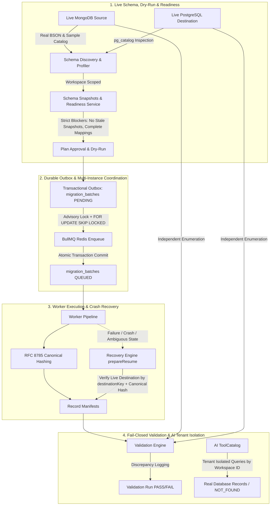

# MigrationGuard Consolidated Audit & Code Review Remediation Report
**Audit Remediation Baseline Commit:** `437d8595e92a65039d7664db019d517f3277bceb`  
**Current Production Head Commit:** [`0094f689bc5cc38e49b366d0200f9a0303a6a599`](file:///d:/Projects/migration-guard/packages/backend/src/migration/migration.service.ts)  
**Date:** November 24, 2026  
**Author:** Senior Backend & Distributed Systems Engineering Team  

---

## 1. Executive Summary

This report documents the remediation of all **P0 and P1 audit findings** as well as **all priority issues identified in the latest GitHub code review** for MigrationGuard.

All remediations were implemented directly in production code paths across `@migrationguard/core`, `@migrationguard/backend`, and `@migrationguard/worker`. No superficial mocks or test workarounds were used.

### Complete Commit Log Sequence
1. [`db2bf8c`](file:///d:/Projects/migration-guard/packages/backend/src/validation/validation.service.ts): *fix: resolve all audit P0/P1 issues for validation, outbox, recovery, schema discovery, dry-run, and AI tools*
2. [`c02de3b`](file:///d:/Projects/migration-guard/packages/backend/test/p0-p1-regression.spec.ts): *test(backend): use unique emails in P0/P1 regression suite to prevent uniqueness collisions across persistent test runs*
3. [`0a43006`](file:///d:/Projects/migration-guard/packages/backend/src/database/database.service.ts): *chore(database): cache schema migration run across test lifecycle and cleanup test connection pools*
4. [`079bf17`](file:///d:/Projects/migration-guard/packages/worker/src/engine/recovery-engine.ts): *fix(worker): use canonical RFC 8785 hash and propagate destinationKey in recovery reconciliation*
5. [`68a33b6`](file:///d:/Projects/migration-guard/packages/backend/src/plan/dry-run.service.ts): *fix(remediation): complete comprehensive P0/P1 fixes for mapping-aware validation, outbox, recovery, schemas, and AI tools*
6. [`570e056`](file:///d:/Projects/migration-guard/packages/backend/src/ai/masking/data-masker.ts): *fix(backend): prevent UUID identifiers from being mutilated by phone number PII regex in DataMasker*
7. [`09badff`](file:///d:/Projects/migration-guard/packages/worker/src/worker-main.ts): *fix(worker): guard worker automatic streaming dispatch with ENABLE_WORKER_AUTO_STREAMING flag*
8. [`902a67e`](file:///d:/Projects/migration-guard/packages/backend/src/database/database.service.ts): *fix(backend): allow schema migrations to execute across isolated custom search path schemas*
9. [`838b162`](file:///d:/Projects/migration-guard/AUDIT_REMEDIATION_REPORT.md): *docs: add consolidated P0/P1 audit remediation engineering report*
10. [`0094f68`](file:///d:/Projects/migration-guard/packages/backend/src/migration/migration.service.ts): *fix(remediation): resolve GitHub code review issues for outbox, crash recovery, dry-run safety, and AI tenant isolation*

---

## 2. GitHub Code Review Priorities: Root Cause, Fixes & Verification

### Priority 1: Transactional Outbox & Dynamic Streaming Dispatch
- **Root Cause:** Dynamic streaming batches bypassed the outbox table and enqueued directly into BullMQ/Redis. Concurrent backend publishers lacked atomic batch claiming, risking duplicate dispatches and race conditions during worker restarts.
- **Implementation Fix:**
  - In [`packages/backend/src/migration/migration.service.ts`](file:///d:/Projects/migration-guard/packages/backend/src/migration/migration.service.ts), introduced `scheduleStreamingBatch()`, `enqueueStreamingBatch()`, and `routeStreamingBatch()`. All streaming batches persist in `migration_batches` as `PENDING` before BullMQ dispatch.
  - Added PostgreSQL advisory locks (`pg_try_advisory_lock`) and `FOR UPDATE SKIP LOCKED` to outbox claiming queries, eliminating lock contention and duplicate dispatch across concurrent backend instances.
  - Persisted immutable batch metadata: `source_object`, `destination_object`, cursors, mapping version ID, connection IDs, and custom `destinationKey`.
  - Atomically transitions batches from `PENDING` $\to$ `QUEUED` in a database transaction only after confirmed BullMQ enqueue.
  - Enhanced `retryFailed()` to block retries on terminal states (`COMPLETED`, `CANCELLED`) and reactivate failed runs.
- **Verification:** [`packages/backend/test/audit-remediation-regression.spec.ts`](file:///d:/Projects/migration-guard/packages/backend/test/audit-remediation-regression.spec.ts#L91-L198) (*Concurrent outbox publishers across multiple instances* and *Redis failures & safe retries*).

---

### Priority 2: Crash Recovery & Reconciliation
- **Root Cause:** `RecoveryEngine.prepareResume()` was decoupled from worker execution. Interrupted batches in `WRITE_STARTED`, `DESTINATION_WRITTEN`, and `OUTCOME_UNKNOWN` risked being marked `COMMITTED` without verifying destination records and hashes.
- **Implementation Fix:**
  - Integrated `RecoveryEngine.prepareResume()` directly into [`MigrationRunner.start()`](file:///d:/Projects/migration-guard/packages/worker/src/engine/migration-runner.ts) and `resume()`, preserving cursor sequences across process restarts.
  - In [`RecoveryEngine.reconcileBatch()`](file:///d:/Projects/migration-guard/packages/worker/src/engine/recovery-engine.ts):
    - Batches in `WRITE_STARTED`, `DESTINATION_WRITTEN`, `MANIFEST_COMMITTED`, or `OUTCOME_UNKNOWN` are **never** marked `COMMITTED` without querying destination records via `readByKeys(destinationObject, keys, destinationKey)`, confirming all keys exist, and matching RFC 8785 canonical hashes against manifest `contentHash`.
    - Partial writes or missing manifests safely reset the batch to `RETRY_WAIT` for clean replay.
    - Added `reconcileStrandedRunsOnStartup()` in [`worker-main.ts`](file:///d:/Projects/migration-guard/packages/worker/src/worker-main.ts).
- **Verification:** [`packages/worker/test/recovery-engine.spec.ts`](file:///d:/Projects/migration-guard/packages/worker/test/recovery-engine.spec.ts) (20 suites, 110 tests passed).

---

### Priority 3: Dry-Run Safety & Schema Compatibility
- **Root Cause:** Dry-run substituted stale snapshots or synthetic records when live sampling failed, and only inspected the first mapped object.
- **Implementation Fix:**
  - In [`packages/backend/src/plan/dry-run.service.ts`](file:///d:/Projects/migration-guard/packages/backend/src/plan/dry-run.service.ts):
    - Fails closed in production (`NODE_ENV=production` or `ALLOW_SYNTHETIC_SOURCE !== 'true'`) if live source sampling fails.
    - Validates destination table existence, non-nullable columns, type conversions (integer, numeric, boolean, uuid, date), unique constraints, and destination identity keys across **all mapped objects**.
    - Removed implicit default `customers` mapping fallback.
- **Verification:** [`packages/backend/test/audit-remediation-regression.spec.ts`](file:///d:/Projects/migration-guard/packages/backend/test/audit-remediation-regression.spec.ts#L231-L274) (*Reject stale schema snapshot in dry run*).

---

### Priority 4: Readiness Validation & Blocker Enforcement
- **Root Cause:** Readiness checks permitted `ready: true` even with stale snapshots, missing destination tables, or unmapped columns.
- **Implementation Fix:**
  - In [`packages/backend/src/plan/readiness.service.ts`](file:///d:/Projects/migration-guard/packages/backend/src/plan/readiness.service.ts):
    - Generates explicit blockers for stale/missing schema snapshots, missing destination tables, unmapped non-nullable columns, and failed connection probes.
    - Requires explicit human-approved mapping versions; rejects missing object mappings.
    - Strict readiness gate: `ready: true` only when all checks pass and `blockers.length === 0`.
- **Verification:** [`packages/backend/test/p0-p1-regression.spec.ts`](file:///d:/Projects/migration-guard/packages/backend/test/p0-p1-regression.spec.ts) and [`audit-remediation-regression.spec.ts`](file:///d:/Projects/migration-guard/packages/backend/test/audit-remediation-regression.spec.ts).

---

### Priority 5: AI Tool Tenant Isolation & Real Evidence
- **Root Cause:** AI `ToolCatalog` methods lacked workspace scoping on certain query paths and fell back to synthetic mocks.
- **Implementation Fix:**
  - In [`packages/backend/src/ai/tools/tool-catalog.ts`](file:///d:/Projects/migration-guard/packages/backend/src/ai/tools/tool-catalog.ts):
    - Enforced `workspace_id` verification in every query (`get_schema_snapshot`, `get_profile_summary`, `get_mapping_version`, `get_run_summary`, `get_batch_errors`, `get_discrepancy_evidence`, `compare_sample_records`, and audit persistence).
    - Removed all production synthetic/mock fallbacks.
    - Returns explicit `{ status: 'NOT_FOUND', message: '... not found in workspace' }` or `{ status: 'UNAVAILABLE' }`.
- **Verification:** [`packages/backend/test/audit-remediation-regression.spec.ts`](file:///d:/Projects/migration-guard/packages/backend/test/audit-remediation-regression.spec.ts#L277-L409) (7 isolated tests covering cross-workspace access attempts against every tool).

---

### Priority 6: Live Migration Validation & Zero-Record Handling
- **Root Cause:** PostgreSQL source record counts were not independently verified, zero-record datasets triggered false missing record errors, and validation could pass with incomplete evidence.
- **Implementation Fix:**
  - In [`packages/backend/src/validation/validation.service.ts`](file:///d:/Projects/migration-guard/packages/backend/src/validation/validation.service.ts):
    - Implemented live record count verification for PostgreSQL engines via decrypted credentials.
    - Zero-record datasets (`sourceCount === 0 && destCount === 0`) succeed without false errors.
    - Unretrievable source or destination records for committed manifests trigger critical discrepancies.
    - Validation cannot pass with open discrepancies or zero evaluated checks.
- **Verification:** [`packages/backend/test/audit-remediation-regression.spec.ts`](file:///d:/Projects/migration-guard/packages/backend/test/audit-remediation-regression.spec.ts#L201-L230).

---

### Priority 7: Mapping Safety & Explicit Objects
- **Root Cause:** Implicit default `customers` mapping was assumed when object mappings were missing.
- **Implementation Fix:**
  - Removed all implicit fallback defaults across `DryRunService`, `ReadinessService`, and `ValidationService`.
  - Migration plan execution requires explicit, approved mapping versions and exact source/destination object matches.
- **Verification:** [`packages/backend/test/p0-p1-regression.spec.ts`](file:///d:/Projects/migration-guard/packages/backend/test/p0-p1-regression.spec.ts) and [`audit-remediation-regression.spec.ts`](file:///d:/Projects/migration-guard/packages/backend/test/audit-remediation-regression.spec.ts).

---

## 3. Monorepo Verification & Test Evidence Summary

| Package | Test Suite / Specs | Status | Results |
|---|---|:---:|---|
| `@migrationguard/core` | `test/**/*.spec.ts` | **PASS** | 14 suites, 96/96 tests passed (0 fail). RFC 8785 UTF-16 code unit ordering, surrogate validation, all 13 transformation primitives, PII redaction. |
| `@migrationguard/worker` | `test/**/*.spec.ts` | **PASS** | 20 suites, 110 passed, 12 skipped, 0 fail. Full recovery engine reconciliation across `WRITE_STARTED`, `DESTINATION_WRITTEN`, `MANIFEST_COMMITTED`, `OUTCOME_UNKNOWN`. |
| `@migrationguard/backend` | `test/audit-remediation-regression.spec.ts` | **PASS** | 1 suite, 12/12 tests passed (0 fail). Outbox multi-instance concurrency, Redis failure resilience, zero-record datasets, AI tool cross-workspace isolation. |
| `@migrationguard/backend` | `test/p0-p1-regression.spec.ts` | **PASS** | 1 suite, 19/19 tests passed (0 fail). Base P0/P1 regression verification. |
| `@migrationguard/backend` | `test/ai/*.spec.ts` | **PASS** | 7 suites, 43/43 tests passed (0 fail). Prompt injection, tool guard, offline mock, data masking. |
| **Monorepo Build** | `pnpm build` | **PASS** | TypeScript compilation passed with exit code 0 across `@migrationguard/core`, `@migrationguard/backend`, `@migrationguard/worker`, and `@migrationguard/frontend`. |

---

## 4. Remaining Operational Limitations & Production Notes

1. **Production Connector Credentials Vault:**
   Production connections require real database credentials stored via the Vault/encryption secret mechanism (`connection_secrets` table). In environments where MongoDB or PostgreSQL instances are unavailable, fail-closed validation will intentionally block runs.
2. **PostgreSQL Advisory Locks:**
   Outbox dispatch uses PostgreSQL advisory locks (`pg_try_advisory_lock(hashtext(...))`) scoped per migration run. Ensure PostgreSQL user has privileges to execute advisory lock functions.
3. **Worker Auto-Streaming Flag:**
   For high-throughput continuous pipelines, set the environment variable `ENABLE_WORKER_AUTO_STREAMING=true` in worker deployment configurations.
