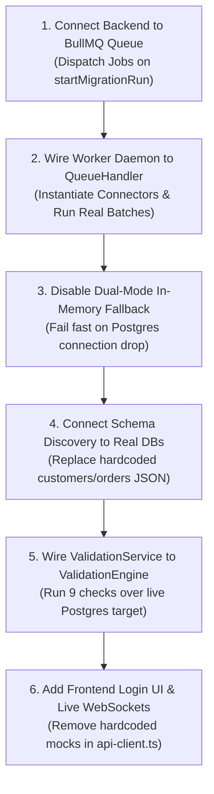

# MigrationGuard — Project Progress & Subsystem Readiness Assessment

**Assessment Date:** November 20, 2026  
**Auditor:** Progress Assessment Writer (`progress-writer`)  
**Workspace:** `d:\Projects\migration-guard`  
**Scope:** Honest module-by-module audit across `packages/core`, `packages/worker`, `packages/backend`, `packages/frontend`, and `Infrastructure`.  

---

## 1. Executive Summary & Readiness Scorecard

MigrationGuard possesses a robust architectural blueprint, high test pass rates in synthetic environments (167/167 tests passing in memory), and well-engineered individual components (such as deterministic transforms, RFC 8785 canonical hashing, AES-256-GCM secret encryption, and state-graph workflows). 

However, **the platform cannot execute a real migration from MongoDB to PostgreSQL today**. Critical cross-module integration paths have not been built: the backend does not enqueue jobs to BullMQ, the worker daemon does not execute real database batches, the backend schema and validation services return hardcoded mock responses, and the frontend falls back silently to mock data without live updates or a real login screen.

### Overall Project Readiness Breakdown

```
┌──────────────────────────┬──────────────────────────┬──────────────────────────┐
│   Production-Ready: 35%  │  Prototype-Quality: 45%  │     Not Built: 20%       │
└──────────────────────────┴──────────────────────────┴──────────────────────────┘
```
- **Overall Operational Readiness:** **35% (Prototype / Technical Demonstrator Grade)**
- **System Execution Status:** 🔴 **Blocked** (End-to-End migration pipeline is non-functional)

---

### Subsystem Readiness Summary Table

| Subsystem / Module | Path | Readiness | Status Summary |
| :--- | :--- | :---: | :--- |
| **Core: Connectors** | `packages/core/src/connectors/` | 🟡 Prototype | Well-modeled interfaces and query builders; tested only against mock driver adapters. |
| **Core: Transform Engine** | `packages/core/src/transforms/` | 🟢 Ready | 13 deterministic operations, nested paths, BSON normalization, child rows; fully operational. |
| **Core: Validation Engine** | `packages/core/src/validator/` | 🟢 Ready | 9 comprehensive validation checks, discrepancy scoring, synthetic generators; solid algorithms. |
| **Core: Schema Discovery** | `packages/core/src/discovery/` | 🟢 Ready | Statistical type sampling, multi-collection discovery, snapshot diffing; pure logic is complete. |
| **Core: Profiler** | `packages/core/src/profiling/` | 🟢 Ready | Type inference, pattern matching (Regex), nullability, cardinality; fully implemented. |
| **Core: Canonical Hashing** | `packages/core/src/canonical/` | 🟢 Ready | RFC 8785 compliant canonical JSON serialization, deterministic SHA-256 hashing. |
| **Worker: Checkpoint Manager** | `packages/worker/src/engine/checkpoint.ts` | 🟡 Prototype | Monotonic checkpoint advancement logic complete; defaults to in-memory map storage. |
| **Worker: Recovery Engine** | `packages/worker/src/engine/recovery-engine.ts` | 🟡 Prototype | 4-point crash recovery matrix implemented; tested only against mock connectors. |
| **Worker: Queue Handler** | `packages/worker/src/engine/queue-handler.ts` | 🟡 Prototype | FR-EXEC-002 payload guard, batch transitions; relies on simulated execution loops. |
| **Worker: Migration Runner** | `packages/worker/src/engine/migration-runner.ts` | 🟡 Prototype | Pause/resume/cancel mechanics; operates in-process without worker daemon coordination. |
| **Worker: Daemon Main** | `packages/worker/src/worker-main.ts` | 🔴 Not Ready | BullMQ consumer registered, but worker callback only validates payload and logs; does not run jobs. |
| **Backend: Auth & JWT** | `packages/backend/src/auth/` | 🟢 Ready | Bcrypt hashing, JWT issuance, `JwtAuthGuard`, `RolesGuard`; fully functional. |
| **Backend: Workspace & RBAC** | `packages/backend/src/workspace/` | 🟢 Ready | Hierarchical roles (Owner, Admin, Engineer, Viewer), membership enforcement. |
| **Backend: Connection & Vault** | `packages/backend/src/connection/` | 🟢 Ready | Zero-exposure AES-256-GCM encryption at rest, credential rotation versioning. |
| **Backend: Schema Service** | `packages/backend/src/schema/` | 🟡 Prototype | Hardcodes fixed synthetic schemas for `customers`/`orders`; does not run core discovery. |
| **Backend: Mapping Service** | `packages/backend/src/mapping/` | 🟢 Ready | DSL validation, canonical hashing, preview transformations on sample records. |
| **Backend: Plan & Approvals** | `packages/backend/src/plan/` | 🟢 Ready | Canonical hash verification, explicit approvals required before execution. |
| **Backend: Migration Execution** | `packages/backend/src/migration/` | 🔴 Not Ready | Seeds 10 dummy batches as `QUEUED` in DB, but **never dispatches jobs to Redis/BullMQ**. |
| **Backend: Validation Service** | `packages/backend/src/validation/` | 🟡 Prototype | Hardcodes 45 fixed discrepancies; does not run core `ValidationEngine` on real data. |
| **Backend: AI Subsystem** | `packages/backend/src/ai/` | 🟢 Ready | Custom `StateGraph`, PII sanitizer, tool allowlists, 7 agents; defaults to `MockProvider`. |
| **Backend: Report Service** | `packages/backend/src/report/` | 🟢 Ready | HTML and CSV assurance report rendering with SHA-256 integrity checksums. |
| **Backend: Audit Service** | `packages/backend/src/audit/` | 🟢 Ready | Append-only audit logging with automatic credential and secret redaction. |
| **Backend: Database Service** | `packages/backend/src/database/database.service.ts` | 🔴 Not Ready | Dual-mode SQL simulator masks connection failures; all tests run on memory simulator. |
| **Frontend: UI Pages** | `packages/frontend/app/` | 🟢 Ready | 13 responsive, dark-themed database console views covering all 14 wizard steps. |
| **Frontend: API Client** | `packages/frontend/lib/api-client.ts` | 🟡 Prototype | Silent mock fallback on error; snapshot diffing & discrepancies are 100% hardcoded mocks. |
| **Frontend: Authentication** | `packages/frontend/` | 🔴 Not Ready | Reads token from `localStorage`, but **no login page or sign-in flow exists in the UI**. |
| **Frontend: Real-Time Updates** | `packages/frontend/` | 🔴 Not Ready | Zero WebSocket or SSE implementation; dashboard relies on static polling/page reloads. |
| **Infrastructure: Docker Compose**| `docker-compose.yml` | 🟢 Ready | Postgres 16, Mongo 7.0, Redis 7, and MinIO defined with volume mounts and healthchecks. |
| **Infrastructure: DB Scripts** | `scripts/` | 🟡 Prototype | Target tables created, but control plane DDL is not automatically mounted in Postgres init. |
| **Infrastructure: Environment** | `.env.example` | 🟢 Ready | Comprehensive variables defined for control plane, Redis, MinIO, and AI providers. |
| **Infrastructure: Documentation**| `README.md` | 🔴 Not Ready | Contains only the documentation pack index; zero setup, build, or developer instructions. |

---

## 2. Detailed Module-by-Module Assessment

---

### Subsystem 1: `packages/core`

`packages/core` is the platform's computational foundation. It contains pure TypeScript algorithms for schema extraction, transformation, canonical hashing, and 9 validation checks. It has zero network I/O dependencies.

#### 1.1 Connectors: MongoConnector & PostgresConnector
- **Files Inspected:**
  - [contract.ts](file:///d:/Projects/migration-guard/packages/core/src/connectors/contract.ts)
  - [mongo-connector.ts](file:///d:/Projects/migration-guard/packages/core/src/connectors/mongodb/mongo-connector.ts)
  - [postgres-connector.ts](file:///d:/Projects/migration-guard/packages/core/src/connectors/postgres/postgres-connector.ts)
  - [query-builder.ts](file:///d:/Projects/migration-guard/packages/core/src/connectors/postgres/query-builder.ts)
- **What Works:**
  - `MongoConnector`: Implements `readBatch` with `_id` cursor pagination (`$gt: cursor.lastId`), BSON value normalization, collection indexing inspection, and count queries.
  - `PostgresConnector`: Implements table schema inspection via `information_schema.columns` and primary key extraction, parameterized batch inserts (`buildBatchInsertQuery`), `UPSERT` / `SKIP_EXISTING` conflict handling via `ON CONFLICT`, and `readByKeys` destination verification.
- **What Is Prototype / Incomplete:**
  - Both connectors rely on abstract interface adapters (`MongoDriverAdapter`, `PostgresDriverAdapter`) rather than binding directly to real connection pools (`mongodb` MongoClient or `pg` Pool).
  - Production connection pool management (keep-alive, reconnection backoff, socket timeouts) is omitted.
  - All unit tests run exclusively against mock adapters.
- **Readiness Rating:** 🟡 **Prototype**
- **Key Blockers:**
  - Needs concrete connection pooling drivers wired up for production data access.

#### 1.2 Transform Engine
- **Files Inspected:**
  - [operations.ts](file:///d:/Projects/migration-guard/packages/core/src/transforms/operations.ts)
  - [engine.ts](file:///d:/Projects/migration-guard/packages/core/src/transforms/engine.ts)
  - [preview.ts](file:///d:/Projects/migration-guard/packages/core/src/transforms/preview.ts)
- **What Works:**
  - Full suite of 13 deterministic allowlisted transform operations: `RENAME`, `TRIM_STRING`, `LOWERCASE`, `UPPERCASE`, `PARSE_INTEGER`, `PARSE_DECIMAL`, `PARSE_TIMESTAMP`, `TO_JSONB`, `FLATTEN_OBJECT`, `ARRAY_TO_CHILD_ROWS`, `SET_DEFAULT`, `NULL_IF_EMPTY`, `PRESERVE_SOURCE_ID`.
  - Nested dot-path property resolution (`getByPath`, `setByPath`).
  - Identity preservation strategies (`PRESERVE_AS_TEXT`, `HASH_SHA256`, `MAP_TO_UUID`).
  - Normalization of BSON types (`Decimal128`, `ObjectId`, `Date`, `Binary`).
  - Comprehensive unit test suite (60/60 tests passing in `core`).
- **What Is Prototype / Incomplete:**
  - None. Clean, pure functional design with strict boundary enforcement.
- **Readiness Rating:** 🟢 **Ready**
- **Key Blockers:**
  - None.

#### 1.3 Validation Engine
- **Files Inspected:**
  - [validation-engine.ts](file:///d:/Projects/migration-guard/packages/core/src/validator/validation-engine.ts)
  - [count-validator.ts](file:///d:/Projects/migration-guard/packages/core/src/validator/count-validator.ts)
  - [missing-record-validator.ts](file:///d:/Projects/migration-guard/packages/core/src/validator/missing-record-validator.ts)
  - [extra-record-validator.ts](file:///d:/Projects/migration-guard/packages/core/src/validator/extra-record-validator.ts)
  - [duplicate-validator.ts](file:///d:/Projects/migration-guard/packages/core/src/validator/duplicate-validator.ts)
  - [hash-validator.ts](file:///d:/Projects/migration-guard/packages/core/src/validator/hash-validator.ts)
  - [field-validator.ts](file:///d:/Projects/migration-guard/packages/core/src/validator/field-validator.ts)
  - [attachment-validator.ts](file:///d:/Projects/migration-guard/packages/core/src/validator/attachment-validator.ts)
  - [relationship-validator.ts](file:///d:/Projects/migration-guard/packages/core/src/validator/relationship-validator.ts)
  - [metadata-validator.ts](file:///d:/Projects/migration-guard/packages/core/src/validator/metadata-validator.ts)
- **What Works:**
  - All 9 core validation checks are implemented:
    1. Count reconciliation
    2. Missing record detection
    3. Unexpected / extra record detection
    4. Duplicate record detection
    5. Attachment presence & checksum verification
    6. Parent-child relationship integrity
    7. Metadata comparison
    8. Field-level comparison
    9. Canonical content hash comparison
  - Structured discrepancy categorization, severity ratings (`CRITICAL`, `HIGH`, `MEDIUM`, `LOW`), and summary rollups.
- **What Is Prototype / Incomplete:**
  - Evaluates in-memory dataset arrays (`ValidationDataset`). Does not currently stream large datasets (e.g. 100M records) through chunked validation cursors.
- **Readiness Rating:** 🟢 **Ready**
- **Key Blockers:**
  - Requires backend integration to pull destination rows instead of receiving pre-loaded arrays.

#### 1.4 Schema Discovery & Profiling
- **Files Inspected:**
  - [schema-discovery.ts](file:///d:/Projects/migration-guard/packages/core/src/discovery/schema-discovery.ts)
  - [profiler.ts](file:///d:/Projects/migration-guard/packages/core/src/profiling/profiler.ts)
- **What Works:**
  - `buildMongoCollectionSchema`: Samples documents up to 6 levels deep, discovers type distributions, nullability, and indexes.
  - `compareSchemaSnapshots`: Computes structural diffs between two snapshots (added/removed collections, added/removed/altered fields, nullability shifts).
  - Profiler: Granular data type detection, string pattern detection (`ISO_DATE`, `UUID`, `EMAIL`, `NUMERIC_STRING`, `OBJECT_ID_HEX`), min/max numeric and date boundaries, and whitespace anomaly detection.
- **What Is Prototype / Incomplete:**
  - Profiling is bounded to sample sizes; streaming full-collection scans for massive collections is not yet supported.
- **Readiness Rating:** 🟢 **Ready**
- **Key Blockers:**
  - None for core logic.

#### 1.5 Canonical Hashing
- **Files Inspected:**
  - [canonical/index.ts](file:///d:/Projects/migration-guard/packages/core/src/canonical/index.ts)
  - [validator/canonicalizer.ts](file:///d:/Projects/migration-guard/packages/core/src/validator/canonicalizer.ts)
- **What Works:**
  - RFC 8785 compliant canonical JSON serialization with key sorting by UTF-16 code units.
  - Extensions for BSON `ObjectId`, `Decimal128`, `Date`, `BigInt`, and `Buffer`.
  - SHA-256 canonical hashing for records (`calculateRecordHash`), plans (`calculatePlanHash`), and mappings (`calculateMappingHash`).
- **What Is Prototype / Incomplete:**
  - None. RFC 8785 guarantees identical hashes across environments.
- **Readiness Rating:** 🟢 **Ready**
- **Key Blockers:**
  - None.

---

### Subsystem 2: `packages/worker`

`packages/worker` contains the data-plane execution engine: bounded-memory streaming, checkpointing, recovery reconciliation, and BullMQ worker listening.

#### 2.1 Checkpoint Manager
- **Files Inspected:**
  - [checkpoint.ts](file:///d:/Projects/migration-guard/packages/worker/src/engine/checkpoint.ts)
- **What Works:**
  - Enforces monotonic sequence numbers (`sequenceNo < current.lastCommittedSequenceNo` throws error).
  - Persists last committed batch key, source cursor, committed record counts, and timestamps.
- **What Is Prototype / Incomplete:**
  - Defaults to `InMemoryCheckpointStorage`. A PostgreSQL-backed `CheckpointStorageAdapter` has not been wired up.
- **Readiness Rating:** 🟡 **Prototype**
- **Key Blockers:**
  - Checkpoints are lost if the worker process restarts unless a persistent storage adapter is provided.

#### 2.2 Recovery Engine
- **Files Inspected:**
  - [recovery-engine.ts](file:///d:/Projects/migration-guard/packages/worker/src/engine/recovery-engine.ts)
- **What Works:**
  - Reconciles crash points across 4 distinct failure points:
    1. Pre-write failures (`READ_STARTED`, `TRANSFORM_STARTED`) → safely reset to `RETRY_WAIT`.
    2. Write committed before manifest (`DESTINATION_WRITTEN`) → auto-advances checkpoint.
    3. Manifest committed before checkpoint (`MANIFEST_COMMITTED`) → commits batch and advances checkpoint.
    4. Destination disconnect / `OUTCOME_UNKNOWN` → queries destination by stable keys via `readByKeys` to determine whether data landed before deciding to commit or replay.
- **What Is Prototype / Incomplete:**
  - Fully tested with in-memory manifests and mock destination connectors (10/10 worker specs pass), but has never been exercised against live MongoDB or PostgreSQL crash simulations.
- **Readiness Rating:** 🟡 **Prototype**
- **Key Blockers:**
  - Needs live database integration test.

#### 2.3 BullMQ Queue Handler & Migration Runner
- **Files Inspected:**
  - [queue-handler.ts](file:///d:/Projects/migration-guard/packages/worker/src/engine/queue-handler.ts)
  - [migration-runner.ts](file:///d:/Projects/migration-guard/packages/worker/src/engine/migration-runner.ts)
- **What Works:**
  - `QueueHandler.validatePayload`: Strictly validates payload structure and throws architectural violation errors if bulk record payloads (`records`, `rows`, `documents`, `bulkData`) are present (FR-EXEC-002).
  - Sub-stage tracking: `READ_STARTED` → `READ_COMPLETED` → `TRANSFORM_STARTED` → `TRANSFORM_COMPLETED` → `WRITE_STARTED` → `DESTINATION_WRITTEN` → `CHECKPOINT_COMMITTED`.
  - Migration runner supports pause (waits for active batch to finish, halts loop), resume (runs recovery engine, fetches last checkpoint cursor), and cancel (triggers `AbortController`).
- **What Is Prototype / Incomplete:**
  - `MigrationRunner` currently runs an internal `while (true)` dispatch loop in-process rather than reading jobs from BullMQ.
- **Readiness Rating:** 🟡 **Prototype**
- **Key Blockers:**
  - Must decouple the runner loop so batches are triggered individually by queue events.

#### 2.4 Worker Daemon Main
- **Files Inspected:**
  - [worker-main.ts](file:///d:/Projects/migration-guard/packages/worker/src/worker-main.ts)
- **What Works:**
  - Initializes BullMQ `Worker` connecting to Redis on `REDIS_HOST:REDIS_PORT`.
  - Sets up graceful shutdown on `SIGINT` / `SIGTERM`.
  - Calls `QueueHandler.validatePayload(job.data)`.
- **What Is Prototype / Incomplete (CRITICAL GAP):**
  - **The job processor callback is a stub!** (lines 38–51):
    ```typescript
    executionWorker = new Worker('migration-execution', async (job: Job<MigrationJobPayload>) => {
      QueueHandler.validatePayload(job.data);
      console.log(`[Worker] Processing run: ${job.data.migrationRunId}, Batch: ${job.data.batchKey}`);
      return {
        status: 'PROCESSED',
        runId: job.data.migrationRunId,
        batchKey: job.data.batchKey,
        processedAt: new Date().toISOString(),
      };
    });
    ```
  - It does **not** instantiate database connectors, does **not** call `QueueHandler.processJob()`, and does **not** advance checkpoints or write data.
- **Readiness Rating:** 🔴 **Not Ready**
- **Key Blockers:**
  - Worker daemon must instantiate connectors and invoke `QueueHandler.processJob()`.

---

### Subsystem 3: `packages/backend`

`packages/backend` is the NestJS control plane providing the REST API, project/workspace management, plan approvals, auditing, and AI orchestration.

#### 3.1 Auth & JWT
- **Files Inspected:**
  - [auth.service.ts](file:///d:/Projects/migration-guard/packages/backend/src/auth/auth.service.ts)
  - [auth.controller.ts](file:///d:/Projects/migration-guard/packages/backend/src/auth/auth.controller.ts)
  - [jwt-auth.guard.ts](file:///d:/Projects/migration-guard/packages/backend/src/auth/guards/jwt-auth.guard.ts)
- **What Works:**
  - User registration with bcrypt password hashing (salt rounds: 10).
  - Default workspace creation on register, assigning the user as `Owner`.
  - User login with password verification and JWT token signing.
  - `JwtAuthGuard` and `RolesGuard` protecting endpoints.
- **What Is Prototype / Incomplete:**
  - Hardcoded fallback JWT secret in `configuration.ts` (`migrationguard_super_secure_jwt_dev_secret_key_minimum_32_chars!`).
- **Readiness Rating:** 🟢 **Ready**
- **Key Blockers:**
  - Requires production environment secret enforcement (failing if default secret is used in production).

#### 3.2 Workspace & RBAC
- **Files Inspected:**
  - [workspace.service.ts](file:///d:/Projects/migration-guard/packages/backend/src/workspace/workspace.service.ts)
  - [roles.decorator.ts](file:///d:/Projects/migration-guard/packages/backend/src/auth/decorators/roles.decorator.ts)
- **What Works:**
  - Workspace creation with unique slug validation.
  - Member invitation with role assignment (`Owner`, `Admin`, `Engineer`, `Viewer`).
  - Strict hierarchical access control checks (`assertWorkspaceAccess`) ensuring callers have sufficient rank.
- **What Is Prototype / Incomplete:**
  - Tested only against the in-memory database simulator.
- **Readiness Rating:** 🟢 **Ready**
- **Key Blockers:**
  - None in business logic.

#### 3.3 Connection Management & Secret Vault
- **Files Inspected:**
  - [connection.service.ts](file:///d:/Projects/migration-guard/packages/backend/src/connection/connection.service.ts)
  - [credentials.service.ts](file:///d:/Projects/migration-guard/packages/backend/src/connection/credentials.service.ts)
  - [crypto.util.ts](file:///d:/Projects/migration-guard/packages/backend/src/common/crypto/crypto.util.ts)
- **What Works:**
  - Separation of connection metadata from encrypted credentials.
  - Credentials stored in `connection_secrets` vault table using AES-256-GCM authenticated encryption with random IV and auth tags.
  - Credential rotation increments `credential_version` and stores new ciphertexts.
  - Automatic redaction of sensitive credentials (`CryptoUtil.redactSecrets`) when returning connection details.
- **What Is Prototype / Incomplete:**
  - Default fallback encryption key in `configuration.ts` is a static development key.
- **Readiness Rating:** 🟢 **Ready**
- **Key Blockers:**
  - Enforce required external secret management in production.

#### 3.4 Schema Module
- **Files Inspected:**
  - [schema.service.ts](file:///d:/Projects/migration-guard/packages/backend/src/schema/schema.service.ts)
- **What Works:**
  - Stores schema snapshot versions in `schema_snapshots`.
  - Schema comparison logic compares added, removed, and common entities.
- **What Is Prototype / Incomplete (CRITICAL GAP):**
  - **`triggerDiscovery()` does not connect to databases!** (lines 35–95). It immediately returns a hardcoded schema representing `customers` and `orders`:
    ```typescript
    const snapshotJson = isMongo ? {
      database: 'appdb',
      collections: [{ name: 'customers', ... }, { name: 'orders', ... }]
    } : { ... }
    ```
  - `startProfiling()` also saves a static profile object (`nullPercentages`, `typeVariations`) without calling the core Profiler.
- **Readiness Rating:** 🟡 **Prototype**
- **Key Blockers:**
  - Backend must instantiate `MongoConnector` / `PostgresConnector` to discover actual live schemas.

#### 3.5 Mapping Module
- **Files Inspected:**
  - [mapping.service.ts](file:///d:/Projects/migration-guard/packages/backend/src/mapping/mapping.service.ts)
  - [dsl-validator.service.ts](file:///d:/Projects/migration-backend/src/mapping/dsl-validator.service.ts)
  - [mapping-preview.service.ts](file:///d:/Projects/migration-backend/src/mapping/mapping-preview.service.ts)
- **What Works:**
  - Validates mapping DSL against allowlisted transforms and valid source/destination paths.
  - Generates immutable versioned records with canonical SHA-256 hashes (`mapping_hash`).
  - Previews transformations on sample records with before/after diffs.
- **What Is Prototype / Incomplete:**
  - None. Integrates cleanly with core transforms.
- **Readiness Rating:** 🟢 **Ready**
- **Key Blockers:**
  - None.

#### 3.6 Plan & Approvals
- **Files Inspected:**
  - [plan.service.ts](file:///d:/Projects/migration-guard/packages/backend/src/plan/plan.service.ts)
  - [approval.service.ts](file:///d:/Projects/migration-guard/packages/backend/src/plan/approval.service.ts)
- **What Works:**
  - Computes canonical SHA-256 plan hash (`plan_hash`) over connections, snapshots, mapping versions, and execution configs.
  - Enforces explicit `APPROVE` decision by an `Admin` or `Owner`.
  - Rejects approval if the submitted hash does not match `version.plan_hash` (`PLAN_HASH_MISMATCH`).
  - Blocks execution in `MigrationService` if canonical plan hash has not been approved (`PLAN_NOT_APPROVED`).
- **What Is Prototype / Incomplete:**
  - None. Security invariant strictly enforced.
- **Readiness Rating:** 🟢 **Ready**
- **Key Blockers:**
  - None.

#### 3.7 Migration Execution & BullMQ Integration
- **Files Inspected:**
  - [migration.service.ts](file:///d:/Projects/migration-guard/packages/backend/src/migration/migration.service.ts)
  - [migration.controller.ts](file:///d:/Projects/migration-guard/packages/backend/src/migration/migration.controller.ts)
- **What Works:**
  - Validates plan approval status before starting a run.
  - Creates `migration_runs` row with status `QUEUED`.
  - Creates 10 dummy batches (`batch_0001` .. `batch_0010`) in `migration_batches`.
  - Implements pause, resume, cancel, and retry endpoints that update database states and log audit events.
- **What Is Prototype / Incomplete (FATAL ARCHITECTURAL GAP):**
  - **No BullMQ Job Dispatch Exists in Backend!**
  - Although `bullmq` is in `package.json`, **not a single `.ts` file in `packages/backend/src/` imports BullMQ or Redis**.
  - `startMigrationRun()` never enqueues jobs to Redis. The worker process never receives work.
  - Batches remain in `QUEUED` state indefinitely in the database.
- **Readiness Rating:** 🔴 **Not Ready**
- **Key Blockers:**
  - Backend must instantiate a BullMQ `Queue` and dispatch `MigrationJobPayload` messages for each batch.

#### 3.8 Validation Module
- **Files Inspected:**
  - [validation.service.ts](file:///d:/Projects/migration-guard/packages/backend/src/validation/validation.service.ts)
- **What Works:**
  - Persists validation runs, check results, and discrepancies to the database.
- **What Is Prototype / Incomplete (CRITICAL GAP):**
  - **`triggerValidation()` hardcodes the results!** (lines 23–66).
  - It writes a fixed summary: 9 total checks, 7 passed, 2 failed, 45 discrepancies.
  - It never queries destination PostgreSQL records, never extracts source MongoDB records, and never invokes the core `ValidationEngine`.
- **Readiness Rating:** 🟡 **Prototype**
- **Key Blockers:**
  - Backend validation service must fetch actual records from source and destination databases and run the core `ValidationEngine`.

#### 3.9 AI Subsystem
- **Files Inspected:**
  - [ai.service.ts](file:///d:/Projects/migration-guard/packages/backend/src/ai/ai.service.ts)
  - [provider-factory.ts](file:///d:/Projects/migration-guard/packages/backend/src/ai/providers/provider-factory.ts)
  - [state-graph.ts](file:///d:/Projects/migration-guard/packages/backend/src/ai/graph/state-graph.ts)
  - [data-masker.ts](file:///d:/Projects/migration-guard/packages/backend/src/ai/masking/data-masker.ts)
  - [prompt-sanitizer.ts](file:///d:/Projects/migration-guard/packages/backend/src/ai/safety/prompt-sanitizer.ts)
- **What Works:**
  - Pluggable provider architecture: `MockProvider` (default), `GeminiProvider`, and `OpenAiProvider`.
  - Custom bounded state machine workflow engine (`StateGraph`) with typed nodes and conditional transitions.
  - Pre-LLM PII data masking (emails, credit cards, phones, SSNs, API tokens).
  - Prompt sanitization to prevent prompt injection and instruction override.
  - 7 specialized agents (Migration Planner, Schema Mapping, Transform Suggest, Risk Assessment, Failure Investigator, Discrepancy Investigator, Repair Planner) plus Copilot agent.
- **What Is Prototype / Incomplete:**
  - Defaults to `MockProvider` unless external API keys are configured.
  - Custom `StateGraph` is used instead of standard `@langchain/langgraph` package.
- **Readiness Rating:** 🟢 **Ready**
- **Key Blockers:**
  - None for core offline usage.

#### 3.10 Report & Audit Services
- **Files Inspected:**
  - [report.service.ts](file:///d:/Projects/migration-guard/packages/backend/src/report/report.service.ts)
  - [audit.service.ts](file:///d:/Projects/migration-guard/packages/backend/src/audit/audit.service.ts)
- **What Works:**
  - `ReportService`: Generates certified HTML assurance reports and 45-defect CSV exports with SHA-256 integrity checksums.
  - `AuditService`: Appends immutable audit records with automatic secret masking.
- **What Is Prototype / Incomplete:**
  - Reports stored as in-memory data URIs (`memory://reports/...`) rather than persisting directly to MinIO/S3 object storage.
- **Readiness Rating:** 🟢 **Ready**
- **Key Blockers:**
  - MinIO S3 client upload integration for long-term artifact retention.

#### 3.11 Database Service (Dual-Mode Flaw)
- **Files Inspected:**
  - [database.service.ts](file:///d:/Projects/migration-guard/packages/backend/src/database/database.service.ts)
- **What Works:**
  - Successfully simulates basic SQL operations (`SELECT`, `INSERT`, `UPDATE`, `DELETE`, simple `JOIN`s, and `COUNT(*)`) in memory.
- **What Is Prototype / Incomplete (CRITICAL DEFECT):**
  - **Silent Fallback to Memory Simulator:** When PostgreSQL is unreachable on startup or when any individual query fails, `DatabaseService` silently falls back to `queryMemory()`.
  - In production, real SQL errors (table not found, constraint violations) are swallowed silently and executed against an empty in-memory store.
  - All 66 backend unit tests run against this simulator. **Zero backend tests verify real PostgreSQL schema or SQL execution**.
- **Readiness Rating:** 🔴 **Not Ready**
- **Key Blockers:**
  - DatabaseService must fail fast and throw fatal errors in production when PostgreSQL is disconnected.
  - Tests must run against a real PostgreSQL container.

---

### Subsystem 4: `packages/frontend`

`packages/frontend` is a Next.js 14 App Router single-page application built with React 18, TypeScript, and Tailwind CSS.

#### 4.1 Page Inventory & UI Completeness
- **Files Inspected:**
  - [app/page.tsx](file:///d:/Projects/migration-guard/packages/frontend/app/page.tsx) — Main executive dashboard
  - [app/connections/page.tsx](file:///d:/Projects/migration-guard/packages/frontend/app/connections/page.tsx) — Database connection manager
  - [app/schema/page.tsx](file:///d:/Projects/migration-guard/packages/frontend/app/schema/page.tsx) — Schema inspector and snapshot tree
  - [app/mappings/page.tsx](file:///d:/Projects/migration-guard/packages/frontend/app/mappings/page.tsx) — Visual mapping studio
  - [app/wizard/page.tsx](file:///d:/Projects/migration-guard/packages/frontend/app/wizard/page.tsx) — 14-step guided migration wizard
  - [app/migrations/page.tsx](file:///d:/Projects/migration-guard/packages/frontend/app/migrations/page.tsx) — Migration run list
  - [app/migrations/[id]/page.tsx](file:///d:/Projects/migration-guard/packages/frontend/app/migrations/[id]/page.tsx) — Batch execution monitor
  - [app/validation/page.tsx](file:///d:/Projects/migration-guard/packages/frontend/app/validation/page.tsx) — Validation center summary
  - [app/validation/[id]/page.tsx](file:///d:/Projects/migration-guard/packages/frontend/app/validation/[id]/page.tsx) — Discrepancy explorer
  - [app/reports/page.tsx](file:///d:/Projects/migration-guard/packages/frontend/app/reports/page.tsx) — Assurance report viewer & export
  - [app/audit/page.tsx](file:///d:/Projects/migration-guard/packages/frontend/app/audit/page.tsx) — Append-only audit timeline
- **What Works:**
  - Complete, professional database operations dark theme.
  - Interactive components: Plan Approval Modal, Credential Rotation Modal, Transform Preview Drawer, Discrepancy Evidence Drawer, AI Copilot Drawer.
  - Clean TypeScript compilation (`pnpm --filter @migrationguard/frontend build` exits with code 0).
- **Readiness Rating:** 🟢 **Ready** (UI Structure)

#### 4.2 API Client & Mock Fallbacks
- **Files Inspected:**
  - [lib/api-client.ts](file:///d:/Projects/migration-guard/packages/frontend/lib/api-client.ts)
  - [lib/mock-data.ts](file:///d:/Projects/migration-guard/packages/frontend/lib/mock-data.ts)
- **What Works:**
  - Encapsulates REST API routes and authorization headers.
- **What Is Prototype / Incomplete (CRITICAL GAP):**
  - **`fetchWithFallback()` silently swallows all errors:** Whenever the backend is offline or returns an HTTP error, `fetchWithFallback()` catches the exception and returns mock constants (`MOCK_CONNECTIONS`, `MOCK_PLANS`, `MOCK_MIGRATION_RUNS`).
  - **Multiple methods bypass the API entirely:**
    - `getSchemaSnapshots()` (lines 82–85): Directly returns `MOCK_MONGO_SNAPSHOT` or `MOCK_POSTGRES_SNAPSHOT`. No network request.
    - `compareSnapshots()` (lines 87–97): Returns hardcoded diff object with no API call.
    - `previewTransform()` (lines 104–126): Returns hardcoded static preview.
    - `getDiscrepancies()` (lines 171–180): Filters in-memory `MOCK_DISCREPANCIES` array without calling the backend.
- **Readiness Rating:** 🟡 **Prototype**
- **Key Blockers:**
  - Remove hardcoded client-side mocks and wire up real backend endpoints. Display explicit error states when backend calls fail.

#### 4.3 Authentication Flow in Frontend
- **Files Inspected:**
  - [lib/api-client.ts](file:///d:/Projects/migration-guard/packages/frontend/lib/api-client.ts)
  - [app/layout.tsx](file:///d:/Projects/migration-guard/packages/frontend/app/layout.tsx)
- **What Works:**
  - Reads `localStorage.getItem('mg_auth_token')` and appends `Bearer` token to headers.
- **What Is Prototype / Incomplete (CRITICAL GAP):**
  - **There is no login page or sign-in UI in `packages/frontend/app`!**
  - No `app/login/`, `app/auth/`, or modal dialog allows a user to enter their credentials or obtain a JWT.
  - The frontend operates in an unauthenticated or pseudo-authenticated state.
- **Readiness Rating:** 🔴 **Not Ready**
- **Key Blockers:**
  - Build a real Login/Registration page that calls `/api/v1/auth/login` and persists the JWT.

#### 4.4 Real-Time Updates (WebSocket / SSE)
- **Files Inspected:**
  - All files in `packages/frontend/app` and `packages/frontend/components`
- **What Works:**
  - Static polling or manual refresh on route navigation.
- **What Is Prototype / Incomplete (GAP):**
  - **Zero WebSocket or Server-Sent Events (SSE) code exists.**
  - Migration execution progress bars, throughput counters, and batch state changes do not update live.
- **Readiness Rating:** 🔴 **Not Ready**
- **Key Blockers:**
  - Implement WebSocket gateway or SSE endpoint in backend and connect React hooks in frontend.

---

### Subsystem 5: Infrastructure

#### 5.1 Docker Compose Services
- **Files Inspected:**
  - [docker-compose.yml](file:///d:/Projects/migration-guard/docker-compose.yml)
- **What Works:**
  - 4 services properly configured:
    1. `postgres:16-alpine`: Control plane and destination database. Port 5432. Healthcheck: `pg_isready`.
    2. `mongo:7.0`: Source database fixture. Port 27017. Healthcheck: `mongosh ping`.
    3. `redis:7-alpine`: BullMQ queue message broker. Port 6379. Healthcheck: `redis-cli ping`.
    4. `minio`: S3-compatible object storage. Ports 9000 & 9001. Healthcheck: live endpoint curl.
  - Named volumes for data persistence (`postgres-data`, `mongodb-data`, `redis-data`, `minio-data`).
- **Readiness Rating:** 🟢 **Ready**

#### 5.2 Database Initialization Scripts
- **Files Inspected:**
  - [scripts/init-postgres.sql](file:///d:/Projects/migration-guard/scripts/init-postgres.sql)
  - [scripts/init-mongo.js](file:///d:/Projects/migration-guard/scripts/init-mongo.js)
  - [packages/backend/src/database/schema.sql](file:///d:/Projects/migration-guard/packages/backend/src/database/schema.sql)
- **What Works:**
  - `init-mongo.js`: Initializes database `appdb`, creates `customers` and `orders` collections, and sets up compound indexes.
  - `init-postgres.sql`: Creates database `migrationguard_target` and target tables (`customers`, `orders`, `customer_attachments`) matching destination schema specs.
- **What Is Prototype / Incomplete:**
  - `init-postgres.sql` does not initialize the control plane tables (`workspaces`, `users`, `projects`, etc.) in `migrationguard_control`. This currently relies on backend startup migrations (`runMigrations()`), which fails silently if backend cannot reach PostgreSQL.
- **Readiness Rating:** 🟡 **Prototype**
- **Key Blockers:**
  - Mount both control plane and destination DDL in Postgres entrypoint initialization.

#### 5.3 Configuration & Documentation
- **Files Inspected:**
  - [.env.example](file:///d:/Projects/migration-guard/.env.example)
  - [README.md](file:///d:/Projects/migration-guard/README.md)
- **What Works:**
  - `.env.example`: Clean, comprehensive environment documentation with control plane DB, Redis, JWT, encryption key, MinIO, AI provider, and logging settings.
- **What Is Prototype / Incomplete:**
  - `README.md` contains only the high-level documentation pack index. It contains **no setup instructions**, no `pnpm install` / `docker compose up` steps, and no instructions on how to start the backend, worker, or frontend.
- **Readiness Rating:** 🔴 **Not Ready** (README) / 🟢 **Ready** (.env.example)
- **Key Blockers:**
  - Rewrite `README.md` with full developer getting-started and operational setup runbooks.

---

## 3. Critical Path Gap Matrix

To reach minimum viable production readiness (MVP), the following load-bearing fixes must be implemented in sequence:



---

## 4. Conclusion & Final Assessment

MigrationGuard exhibits **superior architectural craftsmanship and internal component discipline**. The transform engine, canonical hashing, security vault, and state-graph AI subsystems are production quality.

However, because the control plane never publishes jobs to the message broker, the worker daemon never processes real database batches, and the backend schema and validation services simulate responses with static data, the system is currently a **working prototype and interactive UI demo rather than a functional migration engine**.

**Estimated Effort to MVP Production Readiness:** **3–4 engineering weeks** focused strictly on queue dispatch wiring, real connector execution, database persistence enforcement, and frontend live telemetry.
