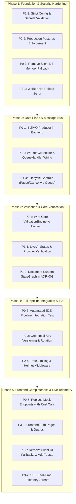

# MigrationGuard — Remediation Plan: Path to Production MVP

**Author:** remediation-writer (automated engineering audit & planning agent)  
**Date:** 2026-11-19  
**Repository:** `d:\Projects\migration-guard`  
**Target Milestone:** MVP Production-Readiness (Reliable, audited, end-to-end MongoDB → PostgreSQL migration)  

---

## Executive Overview

The MigrationGuard codebase provides an exceptionally well-designed structural foundation: clean monorepo architecture, typed domain models, deterministic transform specifications, an exhaustive 9-check validation suite in `packages/core`, and an attractive Next.js operations console.

However, an in-depth audit confirms that **the system is currently an uncoupled prototype / demo**. Crucial operational paths are disconnected, mock fallbacks silently mask missing functionality, and the data plane cannot execute an end-to-end migration.

This document details all identified technical gaps, classified by priority (P0 to P3), with exact file and line evidence, concrete implementation fixes, effort estimates, dependencies, and an end-to-end sequence of execution.

---

## Summary of Identified Gaps

| ID | Priority | Gap Title | Effort | Primary Impact |
|---|---|---|---|---|
| **P0-1** | **P0** | Missing BullMQ Queue Producer in Backend | Medium (1–3d) | Worker never receives migration jobs |
| **P0-2** | **P0** | Worker Process Lacks Real Connector Wiring | Medium (1–3d) | Worker does not read source or write destination |
| **P0-3** | **P0** | DatabaseService Silent In-Memory Fallback & Untested Postgres | Medium (1–3d) | Production SQL errors swallowed; real schema untested |
| **P0-4** | **P0** | Hardcoded Validation Results in Backend | Medium (1–3d) | Real `ValidationEngine` completely bypassed |
| **P0-5** | **P0** | Frontend Client Hardcoded Mock Endpoints & Silent Error Absorption | Small (<1d) | UI never communicates with backend for core ops |
| **P0-6** | **P0** | Total Absence of End-to-End Pipeline Tests | Large (1–2w) | Zero automated proof of end-to-end data integrity |
| **P1-1** | **P1** | AI Subsystem Quietly Defaults to MockProvider | Small (<1d) | AI agents produce canned responses without warning |
| **P1-2** | **P1** | Custom StateGraph Divergence from LangGraph ADR | Small (<1d) | Architectural deviation undocumented |
| **P1-3** | **P1** | Insecure Hardcoded Defaults for Secrets & Database | Small (<1d) | Critical security vulnerability in production |
| **P1-4** | **P1** | Lifecycle Controls (Pause/Resume/Cancel/Retry) Are DB-Only | Medium (1–3d) | Worker ignores pause/cancel signals |
| **P2-1** | **P2** | Worker Daemon Lacks Hot-Reload Development Script | Small (<1d) | Slow developer iteration cycle |
| **P2-2** | **P2** | Missing Production Enforcement of PostgreSQL Connection | Small (<1d) | In-memory RAM store can cause data loss in prod |
| **P2-3** | **P2** | Credential Vault Master Key Management & Rotation Strategy | Medium (1–3d) | Rotating master encryption key invalidates credentials |
| **P2-4** | **P2** | Missing API Rate Limiting & Security Headers (Helmet) | Small (<1d) | Vulnerable to brute-force and web security vectors |
| **P3-1** | **P3** | Complete Absence of Frontend Authentication Flow | Medium (1–3d) | Users cannot log in or register via UI |
| **P3-2** | **P3** | No Real-Time Progress Updates (WebSocket / SSE) | Medium (1–3d) | Dashboard shows static mock data; no live telemetry |
| **P3-3** | **P3** | Silent Fallback Masks Backend Outages from Users | Small (<1d) | Users cannot distinguish between live and dead systems |

---

## 1. P0 Items — Critical Blockers (System Cannot Run a Real Migration)

### P0-1: Missing BullMQ Queue Producer in Backend
- **Priority:** P0 (Critical Blocker)
- **Title:** BullMQ Queue Producer Not Wired in Backend
- **Description:**  
  When an approved plan version is executed via `POST /api/v1/migration-runs`, `MigrationService.startMigrationRun()` records the run in `migration_runs` with status `QUEUED` and creates 10 batch records in `migration_batches`. However, it **never dispatches any message to BullMQ or Redis**. Although `bullmq` and `ioredis` are present in `packages/backend/package.json` and Redis credentials exist in `configuration.ts`, not a single backend `.ts` file imports or instantiates a BullMQ `Queue`. The backend and worker are completely disconnected.
- **Evidence:**  
  - `packages/backend/src/migration/migration.service.ts` (lines 58–103): Creates DB rows and returns immediately without queue interaction.
  - `packages/backend/src/migration/migration.module.ts` (lines 1–13): Imports only `WorkspaceModule`; no BullMQ module or Redis provider is registered.
  - Global codebase search across `packages/backend/src/`: Zero matches for BullMQ queue producer instantiation.
- **Fix:**  
  1. Create a `QueueModule` in `packages/backend/src/queue/` configuring `@nestjs/bullmq` or a dedicated `QueueService` wrapping `bullmq.Queue`.
  2. Define queue names matching the worker (`migration-execution`, `migration-validation`, `schema-discovery`).
  3. Inject `QueueService` into `MigrationService`.
  4. In `startMigrationRun()`, iterate through the seeded batches or first batch and call:
     ```typescript
     await this.queueService.addExecutionJob({
       jobId: `job_${run.id}_${batchKey}`,
       migrationRunId: run.id,
       batchKey,
       sequenceNo: i,
       sourceObject: version.source_collection,
       destinationObject: version.target_table,
       cursorStart: null,
       batchSize,
       planVersionId,
       mappingVersionId: version.mapping_version_id,
       writeMode: 'upsert',
     });
     ```
  5. In `retryFailed()`, push retried batches back onto the BullMQ queue.
- **Effort Estimate:** Medium (1–3 days)
- **Dependencies:** Redis instance accessible (via `docker-compose.yml`).

---

### P0-2: Worker Process Lacks Real Connector Wiring
- **Priority:** P0 (Critical Blocker)
- **Title:** Worker Daemon Runs Dummy Job Processor Without Real Connectors
- **Description:**  
  The worker package contains robust core execution logic (`QueueHandler`, `BatchReader`, `DestinationWriter`, `CheckpointManager`, `ErrorClassifier`), but the actual runtime daemon (`packages/worker/src/worker-main.ts`) does not use them. When a job arrives on the `migration-execution` BullMQ queue, the worker only validates payload structure and returns a dummy `{ status: 'PROCESSED' }`. It does not retrieve credentials, does not instantiate `MongoSourceConnector` or `PostgresDestinationConnector`, and does not invoke `QueueHandler.processJob()`.
- **Evidence:**  
  - `packages/worker/src/worker-main.ts` (lines 36–56):
    ```typescript
    executionWorker = new Worker('migration-execution', async (job) => {
      QueueHandler.validatePayload(job.data);
      console.log(`[Worker] Processing run: ${job.data.migrationRunId}...`);
      return { status: 'PROCESSED', ... };
    });
    ```
  - `packages/worker/src/engine/queue-handler.ts` (lines 51–76): Requires `SourceConnector`, `DestinationConnector`, and `BatchManifestTracker` in constructor, but is never initialized in `worker-main.ts`.
- **Fix:**  
  1. In `worker-main.ts`, establish a database connection pool to the control plane PostgreSQL database to query connection credentials and update batch manifests.
  2. Implement a `ConnectorFactory` in worker that resolves connection secrets from `connection_secrets` (using AES-256-GCM decryption) and instantiates:
     - `MongoSourceConnector` with bounded stream reading.
     - `PostgresDestinationConnector` with batch idempotent upsert capability.
  3. Wire `BatchManifestTracker` and `CheckpointManager` against the PostgreSQL database.
  4. In `executionWorker` processor callback, instantiate `QueueHandler` and execute `await queueHandler.processJob(job.data)`.
  5. Handle chaining of subsequent batches when `result.hasMore === true` by pushing `result.nextPayload` back to the BullMQ queue.
- **Effort Estimate:** Medium (1–3 days)
- **Dependencies:** P0-1 (BullMQ producer in backend), control plane PostgreSQL access.

---

### P0-3: DatabaseService Silent In-Memory Fallback & Untested PostgreSQL
- **Priority:** P0 (Critical Blocker)
- **Title:** DatabaseService Silent Degradation to Memory Store & Untested Schema
- **Description:**  
  `DatabaseService` in `packages/backend` implements an in-memory SQL simulator fallback. When PostgreSQL is unreachable on startup (timeout 2000ms), it warns and switches to `memoryStore`. Critically, line 116 catches *any* runtime SQL query exception on an active connection and silently falls back to `this.queryMemory()`. The in-memory simulator has severe syntax limitations (it supports only 3 hardcoded JOINs, cannot evaluate OR/parenthetical WHERE conditions, cannot execute subqueries, ignores arithmetic expressions in UPDATE, and returns an invalid type on DELETE). Furthermore, all 66 backend tests run against this in-memory simulator, meaning PostgreSQL schema migrations (`scripts/init-postgres.sql`) and SQL queries are completely unverified in CI.
- **Evidence:**  
  - `packages/backend/src/database/database.service.ts` (lines 34–39, 107–120):
    ```typescript
    } catch (err) {
      return this.queryMemory<T>(text, params); // Line 116: silently masks real SQL errors
    }
    ```
  - `database.service.ts` (line 454): `return { rows: deletedCount as unknown as any, rowCount: deletedCount };` (type mismatch bug).
  - `packages/backend/test/validation-report.spec.ts` (lines 21–25): Explicitly runs `db = new DatabaseService(); await db.onModuleInit(); db.resetMemoryStore();` in every test.
- **Fix:**  
  1. Remove runtime `catch (err) { return this.queryMemory(...) }` in `query()`. Real SQL errors in PostgreSQL must throw immediately so bugs are detected and logged.
  2. Introduce an explicit environment flag `ALLOW_IN_MEMORY_DB=true`. If `NODE_ENV === 'production'` or `ALLOW_IN_MEMORY_DB` is false, failed database connection must throw a fatal error and terminate the process.
  3. Fix the memory store type bug in `handleMemoryDelete` (return empty array `rows: []`).
  4. Configure test infrastructure (via Docker Compose or `@testcontainers/postgresql`) so the backend test suite executes against real PostgreSQL 16.
- **Effort Estimate:** Medium (1–3 days)
- **Dependencies:** Docker or PostgreSQL instance available in local/CI environment.

---

### P0-4: Hardcoded Validation Results in Backend
- **Priority:** P0 (Critical Blocker)
- **Title:** ValidationService Bypasses ValidationEngine with Hardcoded 45 Defects
- **Description:**  
  `packages/core/src/validator/validation-engine.ts` contains a high-quality, fully implemented 9-check validation suite (`CountValidator`, `MissingRecordValidator`, `ExtraRecordValidator`, `DuplicateValidator`, `HashValidator`, `FieldValidator`, `AttachmentValidator`, `RelationshipValidator`, `MetadataValidator`). However, `ValidationService.triggerValidation()` in `packages/backend/src/validation/validation.service.ts` completely ignores `ValidationEngine`. It inserts hardcoded constants directly into the DB: a fixed 45 discrepancies, fixed check results (marking CHK-004, CHK-007, CHK-008, CHK-009 as FAIL), and 4 sample discrepancy records. No actual comparison of source MongoDB data and destination PostgreSQL data is performed.
- **Evidence:**  
  - `packages/backend/src/validation/validation.service.ts` (lines 23–111):
    ```typescript
    const summary = { totalChecks: 9, passedChecks: 7, failedChecks: 2, discrepancies: 45, ... };
    // Hardcodes checks CHK-001 through CHK-009 and 4 sample discrepancies
    ```
- **Fix:**  
  1. Integrate `ValidationEngine` from `@migrationguard/core` into `ValidationService` (or offload it as an asynchronous BullMQ worker job on `migration-validation`).
  2. Implement data extractors that pull source records from MongoDB and migrated records from PostgreSQL for the corresponding `migration_run_id`.
  3. Execute `const report = await validationEngine.validate({ sourceRecords, destinationRecords, mappings, options })`.
  4. Iterate through `report.checkResults` and `report.discrepancies` and persist the real computed results into `validation_check_results` and `discrepancies` tables.
- **Effort Estimate:** Medium (1–3 days)
- **Dependencies:** P0-2 (Connectors available to extract source and destination data).

---

### P0-5: Frontend Client Hardcoded Mock Endpoints & Silent Error Absorption
- **Priority:** P0 (Critical Blocker)
- **Title:** Frontend ApiClient Employs Hardcoded Responses and Swallows Backend Errors
- **Description:**  
  `packages/frontend/lib/api-client.ts` acts as a facade that prevents genuine frontend-backend integration. Multiple key methods (`compareSnapshots`, `getDiscrepancies`, `getSchemaSnapshots`, `previewTransform`) never invoke `fetch()` and simply return in-memory mock structures. Furthermore, `fetchWithFallback()` catches any HTTP error (such as 401, 500) or network disconnection and silently returns fallback mock objects. Consequently, the UI displays demo data without warning the user that the backend is down or that operations failed.
- **Evidence:**  
  - `packages/frontend/lib/api-client.ts` (lines 39–57, 82–97, 104–126, 171–180):
    ```typescript
    async compareSnapshots(...) { return { compatible: true, ... }; } // Zero HTTP call
    async getDiscrepancies(...) { return MOCK_DISCREPANCIES.filter(...); } // Zero HTTP call
    ```
  - `packages/frontend/app/page.tsx` (lines 33–35): Initializes component state directly with `MOCK_MIGRATION_RUNS`, `MOCK_VALIDATION_RUN`, `MOCK_AUDIT_EVENTS`.
- **Fix:**  
  1. Implement corresponding backend REST endpoints:
     - `POST /api/v1/schemas/compare`
     - `GET /api/v1/schemas/snapshots/:connectionId`
     - `POST /api/v1/mappings/preview`
     - `GET /api/v1/migration-runs/:id/discrepancies`
  2. In `api-client.ts`, replace hardcoded stubs with real `fetch()` calls to these endpoints.
  3. Refactor `fetchWithFallback()`: remove silent catch-and-return fallback. In case of error, throw a structured `ApiError` and display error toast notifications in the UI.
  4. Update `page.tsx` to display a skeleton/loader until real data is fetched, and show a clear error banner if the backend is unreachable.
- **Effort Estimate:** Small (< 1 day)
- **Dependencies:** Backend endpoints implemented.

---

### P0-6: Total Absence of End-to-End Pipeline Tests
- **Priority:** P0 (Critical Blocker)
- **Title:** No End-to-End Automated Test for Full Migration Lifecycle
- **Description:**  
  Currently, `packages/backend` tests only controller/service logic against the in-memory simulator, `packages/worker` tests unit components with mock connectors, and `packages/core` tests in-memory validation datasets. There is no automated test that exercises the entire system: triggering a migration via API, having BullMQ deliver jobs to the worker, reading documents from a live MongoDB container, applying transformations, writing to a live PostgreSQL container, verifying checkpoints, running the validation engine, and asserting zero data corruption.
- **Evidence:**  
  - Monorepo package test suites (`packages/backend/test`, `packages/worker/test`, `packages/core/test`): Zero cross-package integration tests.
  - Absence of Playwright, Cypress, or integration test runners configured for Dockerized services.
- **Fix:**  
  1. Create `test/e2e/` at the repository root or within `packages/backend/test/e2e/`.
  2. Utilize Docker Compose or Testcontainers to spin up MongoDB, PostgreSQL, and Redis.
  3. Seed MongoDB with test collections (e.g. 5,000 customers, orders with embedded documents and attachments).
  4. Execute an automated test scenario:
     - Log in and retrieve JWT.
     - Create connections, discover schemas, approve plan hash.
     - Call `POST /api/v1/migration-runs`.
     - Await worker completion via polling or BullMQ event listener.
     - Query PostgreSQL `migration_dest` and assert record count, transformed field values, and idempotency.
     - Trigger validation and verify that expected discrepancies match seed defects exactly.
- **Effort Estimate:** Large (1–2 weeks)
- **Dependencies:** P0-1, P0-2, P0-3, P0-4.

---

## 2. P1 Items — Major Features Missing (AI, Security & Lifecycle)

### P1-1: AI Subsystem Quietly Defaults to MockProvider
- **Priority:** P1 (Major Feature Gap)
- **Title:** AI Agents Silently Fall Back to Offline Mock Without Operator Notification
- **Description:**  
  The AI architecture is structured cleanly around `AiProviderAdapter` and state graphs (`packages/backend/src/ai/`), supporting `GeminiProvider` and `OpenAiProvider`. However, if `AI_PROVIDER` and API keys are not explicitly configured in `.env`, `provider-factory.ts` defaults to `MockProvider`. All AI capabilities (planner, mapping suggestions, discrepancy investigator, repair agent) return canned responses. There is no UI warning or startup log indicating that the system is running in dummy AI mode.
- **Evidence:**  
  - `packages/backend/src/ai/providers/provider-factory.ts` (lines 35–38):
    ```typescript
    console.log('[AiProviderFactory] Using deterministic MockProvider (offline)');
    return new MockProvider();
    ```
- **Fix:**  
  1. Add an AI status endpoint `GET /api/v1/ai/status` reporting active provider (`mock`, `gemini`, `openai`), model version, and connectivity status.
  2. In the frontend AI Copilot drawer and navigation bar, display a status badge (e.g., `Mock Mode` vs `Gemini 1.5 Pro Live`).
  3. Provide a CLI command `pnpm test:ai-live` that performs a live ping/completion against the configured LLM provider and verifies response schema parsing.
  4. Ensure `.env.example` explicitly highlights `AI_PROVIDER`, `GEMINI_API_KEY`, and `OPENAI_API_KEY`.
- **Effort Estimate:** Small (< 1 day)
- **Dependencies:** Valid API key for Gemini or OpenAI.

---

### P1-2: Custom StateGraph Divergence from LangGraph ADR
- **Priority:** P1 (Architectural Alignment)
- **Title:** Undocumented Custom StateGraph Reimplementation Deviating from ADR-008
- **Description:**  
  `13_ARCHITECTURE_DECISIONS.md` includes ADR-008 ("LangGraph behind provider/tool boundaries"), stating: *"Decision: Use LangGraph for multi-step AI workflows"*. However, `@langchain/langgraph` is not installed in `package.json`. Instead, `packages/backend/src/ai/graph/state-graph.ts` is a bespoke in-house state machine. While it works well for simple graphs, this architectural change is not documented, ADR-008 remains listed as "Proposed", and the custom implementation lacks LangGraph's enterprise ecosystem features (time-travel debugging, persistent checkpointers, graph visualization).
- **Evidence:**  
  - `13_ARCHITECTURE_DECISIONS.md` (lines 56–61): "Status: Proposed".
  - `packages/backend/package.json`: No `@langchain/langgraph` dependency.
  - `packages/backend/src/ai/graph/state-graph.ts` (lines 1–250): Custom implementation.
- **Fix:**  
  1. Update ADR-008 in `13_ARCHITECTURE_DECISIONS.md` to `Status: Accepted`.
  2. Document the deliberate architectural decision: custom zero-dependency `StateGraph` chosen for MVP to avoid heavy LangGraph dependency tree and ensure deterministic offline execution.
  3. Define boundary requirements: if multi-turn human-in-the-loop state resumption across server restarts is required in Phase 2, evaluate migrating to official `@langchain/langgraph`.
- **Effort Estimate:** Small (< 1 day)
- **Dependencies:** None.

---

### P1-3: Insecure Hardcoded Defaults for Secrets & Database
- **Priority:** P1 (Security Vulnerability)
- **Title:** Hardcoded Secrets and Passwords in Configuration Fallbacks
- **Description:**  
  `packages/backend/src/config/configuration.ts` embeds sensitive fallback secrets directly in source code:
  - `jwtSecret`: `'migrationguard_super_secure_jwt_dev_secret_key_minimum_32_chars!'`
  - `encryptionKey`: `'0123456789abcdef0123456789abcdef0123456789abcdef0123456789abcdef'`
  - `databaseUrl`: contains default password `'postgres_secret_password'`.
  If an administrator deploys the application without setting environment variables, any user can forge administrator JWTs and decrypt vaulted database passwords.
- **Evidence:**  
  - `packages/backend/src/config/configuration.ts` (lines 23, 30–31, 34–35).
- **Fix:**  
  1. Modify `configuration.ts` to enforce strict validation:
     ```typescript
     if (process.env.NODE_ENV === 'production') {
       if (!process.env.JWT_SECRET || process.env.JWT_SECRET.includes('dev_secret')) {
         throw new Error('FATAL: Secure JWT_SECRET environment variable is mandatory in production');
       }
       if (!process.env.ENCRYPTION_KEY || process.env.ENCRYPTION_KEY.startsWith('0123456789')) {
         throw new Error('FATAL: Secure 64-character hex ENCRYPTION_KEY is mandatory in production');
       }
     }
     ```
  2. Disallow startup if default secrets are detected in production mode.
  3. Update `.env.example` with instructions on generating cryptographically secure keys (e.g. `openssl rand -hex 32`).
- **Effort Estimate:** Small (< 1 day)
- **Dependencies:** None.

---

### P1-4: Lifecycle Controls (Pause / Resume / Cancel / Retry) Are DB-Only
- **Priority:** P1 (Data Plane Integrity)
- **Title:** Migration Lifecycle Operations Do Not Propagate to Worker or BullMQ
- **Description:**  
  In `packages/backend/src/migration/migration.service.ts`, `pauseRun()`, `resumeRun()`, `cancelRun()`, and `retryFailed()` only execute SQL updates against `migration_runs` and `migration_batches`. They do not pause BullMQ queues, cancel in-flight worker executions, or notify the worker daemon. If a user cancels an active run because of catastrophic data corruption, the worker will continue processing and writing records until its queue drains.
- **Evidence:**  
  - `packages/backend/src/migration/migration.service.ts` (lines 154–238): Updates DB rows and writes audit events, but has no queue or worker signaling.
- **Fix:**  
  1. In `pauseRun()`, call `await executionQueue.pause()`.
  2. In `resumeRun()`, call `await executionQueue.resume()`.
  3. In `cancelRun()`, drain/obliterate pending jobs for the run ID in BullMQ and publish a Redis cancellation event.
  4. In `QueueHandler` (worker), check run status or listen to Redis pub/sub cancellation events before committing each batch; abort batch write if run has been cancelled.
- **Effort Estimate:** Medium (1–3 days)
- **Dependencies:** P0-1, P0-2.

---

## 3. P2 Items — Infrastructure & Reliability Gaps

### P2-1: Worker Daemon Lacks Hot-Reload Development Script
- **Priority:** P2 (Developer Experience)
- **Title:** Worker Dev Script Requires Manual Recompilation and Restart
- **Description:**  
  In `packages/worker/package.json`, `"start:dev"` is defined as `"tsc -p tsconfig.json && node dist/worker-main.js"`. It compiles TypeScript once and runs the output file once. Any edits to worker code require manually killing the process, recompiling, and restarting.
- **Evidence:**  
  - `packages/worker/package.json` (line 20).
- **Fix:**  
  1. Add `tsx` or `ts-node-dev` as a dev dependency in `packages/worker`.
  2. Update `scripts` in `packages/worker/package.json`:
     ```json
     "start:dev": "tsx watch src/worker-main.ts"
     ```
- **Effort Estimate:** Small (< 1 day)
- **Dependencies:** None.

---

### P2-2: Missing Production Enforcement of PostgreSQL Connection
- **Priority:** P2 (Reliability & Data Durability)
- **Title:** In-Memory Fallback Permitted in Production Environments
- **Description:**  
  `DatabaseService` silently falls back to in-memory storage if PostgreSQL fails to connect. If this occurs in a production Docker deployment (e.g. database container startup race condition or network partition), the backend will accept API calls, "save" plans and connection secrets in RAM, and subsequently lose everything when the container restarts.
- **Evidence:**  
  - `packages/backend/src/database/database.service.ts` (lines 34–39).
- **Fix:**  
  1. In `DatabaseService.onModuleInit()`:
     ```typescript
     if (!this.isConnected) {
       if (process.env.NODE_ENV === 'production' || process.env.REQUIRE_POSTGRES === 'true') {
         throw new Error('[DatabaseService] FATAL: PostgreSQL connection failed in production mode.');
       }
     }
     ```
  2. Ensure Kubernetes/Docker health checks fail if `DatabaseService.isDbConnected` is false.
- **Effort Estimate:** Small (< 1 day)
- **Dependencies:** None.

---

### P2-3: Credential Vault Master Key Management & Rotation Strategy
- **Priority:** P2 (Security & Compliance)
- **Title:** Single Static Master Key Without Key Versioning or Re-Encryption Workflow
- **Description:**  
  Database connection credentials are encrypted with AES-256-GCM and stored in `connection_secrets`. However, there is no key versioning column in `connection_secrets` referencing which master key was used. If an enterprise operator rotates the master `ENCRYPTION_KEY` in environment variables, all previously stored credentials immediately fail decryption and throw runtime errors.
- **Evidence:**  
  - `packages/backend/src/connection/credentials.service.ts` (lines 12–21, 26–50): Only records credential version (`version`), not master key ID.
  - `scripts/init-postgres.sql`: `connection_secrets` table lacks `master_key_version` column.
- **Fix:**  
  1. Add `master_key_version INT NOT NULL DEFAULT 1` to `connection_secrets` table.
  2. Implement a `KeyManagementService` supporting a keyring of historical keys.
  3. Create a CLI command `pnpm vault:re-encrypt` that decrypts secrets encrypted with older key versions and re-encrypts them with the current active master key.
- **Effort Estimate:** Medium (1–3 days)
- **Dependencies:** P1-3.

---

### P2-4: Missing API Rate Limiting & Security Headers
- **Priority:** P2 (Security Hardening)
- **Title:** Public Endpoints Lack Rate Limiting and Helmet Headers
- **Description:**  
  `packages/backend` does not include `@nestjs/throttler` or `helmet`. Sensitive public endpoints like `/api/v1/auth/login` and `/api/v1/auth/register` have no rate limiting, leaving them susceptible to brute-force credential stuffing. HTTP responses also lack standard OWASP security headers (CSP, HSTS, X-Content-Type-Options).
- **Evidence:**  
  - `packages/backend/package.json`: No `helmet` or `@nestjs/throttler` installed.
  - `packages/backend/src/main.ts`: No security middleware applied.
- **Fix:**  
  1. Install `helmet` and `@nestjs/throttler` in `packages/backend`.
  2. Apply `app.use(helmet())` in `main.ts`.
  3. Configure `ThrottlerModule.forRoot([{ ttl: 60000, limit: 100 }])` in `AppModule`, with a tighter limit (e.g. 5 requests/min) on `AuthController`.
- **Effort Estimate:** Small (< 1 day)
- **Dependencies:** None.

---

## 4. P3 Items — Frontend & UX Gaps

### P3-1: Complete Absence of Frontend Authentication Flow
- **Priority:** P3 (User Experience)
- **Title:** Frontend Missing Login/Register Pages and Auth Route Guards
- **Description:**  
  Although the backend implements complete JWT authentication (`AuthService`, `JwtAuthGuard`, `WorkspaceGuard`), the frontend repository (`packages/frontend`) has no auth pages. There is no `app/auth/` directory, no `/login` route, and no form to enter credentials. `api-client.ts` attempts to read `localStorage.getItem('mg_auth_token')`, but nothing in the application ever sets this token. The user interface can only be operated unauthenticated.
- **Evidence:**  
  - `packages/frontend/app/`: Directory listing shows `audit`, `connections`, `mappings`, `migrations`, `reports`, `schema`, `validation`, `wizard`. No `auth` directory exists.
  - `packages/frontend/lib/api-client.ts` (line 31): Reads token, but no code sets it.
- **Fix:**  
  1. Create `packages/frontend/app/auth/login/page.tsx` and `register/page.tsx`.
  2. Implement an `AuthProvider` React Context storing user info and JWT in `localStorage` / secure cookies.
  3. Implement a Next.js middleware (`middleware.ts`) that redirects unauthenticated users to `/auth/login` unless navigating public routes.
  4. Add a user profile badge and logout button in the application sidebar.
- **Effort Estimate:** Medium (1–3 days)
- **Dependencies:** Backend Auth endpoints functional.

---

### P3-2: No Real-Time Progress Updates (WebSocket / SSE)
- **Priority:** P3 (User Experience)
- **Title:** Dashboard and Run Monitors Lack Real-Time Streaming Telemetry
- **Description:**  
  The dashboard and migration execution pages present real-time visual progress bars and live throughput metrics (`rec/sec`), but these values are static mock data loaded once via `useEffect`. The backend lacks WebSocket gateways or Server-Sent Events (SSE) controllers. A user monitoring a 1,000,000-record migration has to manually reload the browser page to observe progress.
- **Evidence:**  
  - `packages/backend/package.json`: No `@nestjs/websockets` or `socket.io`.
  - `packages/frontend/app/page.tsx` (lines 38–49): One-off fetch on mount, no subscription.
- **Fix:**  
  1. Add an SSE controller endpoint in `packages/backend/src/migration/migration.controller.ts`:
     ```typescript
     @Sse(':id/progress-stream')
     streamProgress(@Param('id') runId: string): Observable<MessageEvent>
     ```
  2. Emit progress updates from worker to Redis Pub/Sub; have the backend subscribe and push SSE messages.
  3. In `packages/frontend`, create a `useMigrationProgress(runId)` custom hook using standard browser `EventSource` to update state dynamically.
- **Effort Estimate:** Medium (1–3 days)
- **Dependencies:** P0-1, P0-2.

---

### P3-3: Silent Fallback Masks Backend Outages from Users
- **Priority:** P3 (Operational Awareness)
- **Title:** UI Displays Healthy Mock State When Backend Is Offline
- **Description:**  
  Because `fetchWithFallback()` catches network failures and returns mock objects, stopping the backend process does not produce any visible change in the frontend. The dashboard continues displaying "Mission Control Overview - Live Pipeline", green checkmarks, and 45 discrepancies. Operators cannot determine if the system is live or offline.
- **Evidence:**  
  - `packages/frontend/lib/api-client.ts` (lines 49–56):
    ```typescript
    if (!res.ok) return fallbackData;
    } catch {
      return fallbackData;
    }
    ```
- **Fix:**  
  1. Remove automatic mock fallbacks from `api-client.ts` in production mode.
  2. Add a `SystemHealthBanner` component in `layout.tsx` that polls `/api/v1/health` and alerts the user when disconnected:
     > ⚠️ Disconnected from MigrationGuard Control Plane. Real-time telemetry paused.
  3. Integrate `sonner` or `react-hot-toast` to surface actionable HTTP errors on failed mutations.
- **Effort Estimate:** Small (< 1 day)
- **Dependencies:** None.

---

## 5. Total Effort Estimate to Reach MVP Production-Readiness

| Workstream | Items Covered | Estimated Days |
|---|---|---|
| **P0: Core Data Plane & Integration** | P0-1 (BullMQ), P0-2 (Worker Wiring), P0-3 (Postgres Enforcement), P0-4 (Validation Engine Integration) | 6–10 days |
| **P0: End-to-End Test Suite** | P0-6 (Automated Dockerized Pipeline Test) | 5–8 days |
| **P1: Security & AI Productionizing** | P1-1 (AI Visibility), P1-2 (ADR-008), P1-3 (Secrets Hardening), P1-4 (Queue Lifecycle Controls) | 3–5 days |
| **P2: Infrastructure & Resilience** | P2-1 (Worker Watch), P2-2 (DB Fail-Fast), P2-3 (Vault Rotation), P2-4 (Rate Limiting) | 3–5 days |
| **P3: Frontend & UX Completeness** | P0-5 (Real API Wiring), P3-1 (Auth Flow), P3-2 (SSE Telemetry), P3-3 (Error Feedback) | 4–7 days |
| **Buffer / Regression Testing** | Cross-platform verification, failure injection, documentation updates | 3–5 days |
| **TOTAL TO MVP READINESS** | **All 17 Gaps Remediated** | **24–40 Engineering Days (~5–8 weeks for 1 engineer; ~2.5–3.5 weeks for team of 2–3)** |

---

## 6. Recommended Fix Sequence (Dependency-Ordered Roadmap)

To minimize rework and unlock testability early, remediations must be executed in the following 5 phases:



### Phase 1: Foundation & Security Hardening (Days 1–3)
- **Objective:** Ensure the control plane fails fast, uses verified PostgreSQL, and rejects insecure defaults.
- **Tasks:**
  1. Fix `packages/backend/src/config/configuration.ts`: disallow dev secret fallbacks in production (P1-3).
  2. Update `packages/backend/src/database/database.service.ts`: eliminate silent fallback to in-memory store on SQL errors; throw fatal error on DB connection failure in production (P0-3, P2-2).
  3. Fix return type bug in `handleMemoryDelete` (P0-3).
  4. Add `tsx watch` to `packages/worker/package.json` for hot reload (P2-1).

### Phase 2: Data Plane & Message Bus Integration (Days 4–8)
- **Objective:** Enable end-to-end job queuing and real worker data execution.
- **Tasks:**
  1. Implement BullMQ queue producer in `packages/backend/src/migration/` and dispatch jobs in `startMigrationRun()` and `retryFailed()` (P0-1).
  2. Implement connector instantiation and `QueueHandler.processJob()` in `packages/worker/src/worker-main.ts` (P0-2).
  3. Wire pause, resume, and cancel signals to BullMQ queues and worker execution loops (P1-4).

### Phase 3: Validation Engine & AI Verification (Days 9–12)
- **Objective:** Replace mock validation with real dataset reconciliation and clarify AI architecture.
- **Tasks:**
  1. Wire `ValidationEngine` from `@migrationguard/core` into `ValidationService`, reading real source Mongo and target Postgres datasets (P0-4).
  2. Add AI provider status endpoint and smoke-test CLI command (P1-1).
  3. Update `13_ARCHITECTURE_DECISIONS.md` ADR-008 to reflect the accepted custom StateGraph implementation (P1-2).

### Phase 4: Automated E2E Pipeline Testing & Security (Days 13–19)
- **Objective:** Certify complete migration fidelity with automated tests and enterprise hardening.
- **Tasks:**
  1. Author automated Dockerized E2E test exercising API → Queue → Worker → Mongo Read → Postgres Write → Validation (P0-6).
  2. Implement key versioning in `connection_secrets` and vault re-encryption CLI (P2-3).
  3. Add `helmet` and `@nestjs/throttler` middleware (P2-4).

### Phase 5: Frontend Integration & Live Telemetry (Days 20–26)
- **Objective:** Connect the Next.js UI to real APIs, live streaming, and full authentication.
- **Tasks:**
  1. Implement real API calls in `packages/frontend/lib/api-client.ts`, replacing hardcoded mocks (P0-5).
  2. Create `/auth/login` and `/auth/register` pages in frontend with JWT session management (P3-1).
  3. Remove silent fallbacks in `api-client.ts` and add error toast notifications and health banner (P3-3).
  4. Implement SSE telemetry endpoint in backend and live stream hook in frontend dashboard (P3-2).

---

*Remediation plan complete. Ready for architectural review and engineering sprint planning.*
